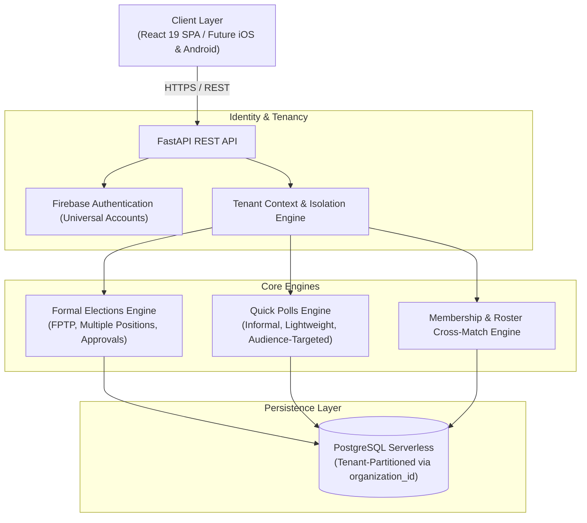
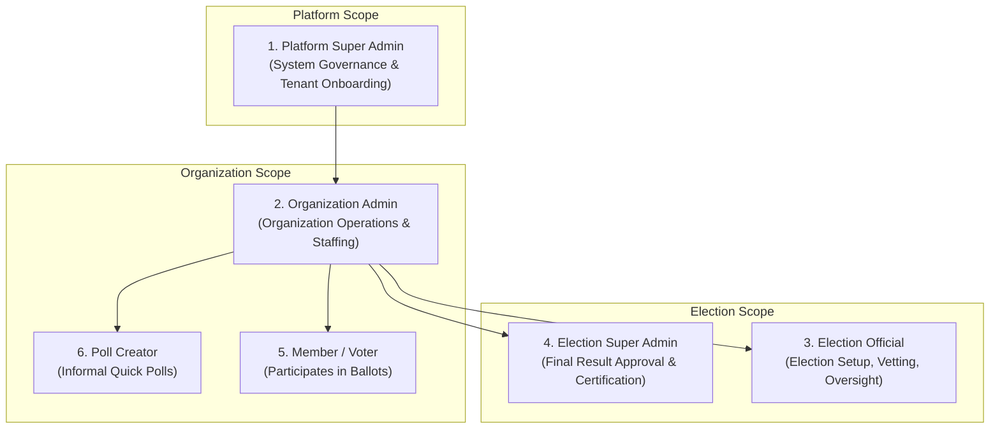

# ARCHITECTURE.md — UniVote Multi-Tenant Architecture

This document provides a comprehensive analysis of the architectural design, security boundaries, multi-tenant patterns, and deployment topologies for **UniVote**.

For in-depth sub-specifications, see:
- [docs/architecture/SYSTEM_ARCHITECTURE.md](docs/architecture/SYSTEM_ARCHITECTURE.md)
- [docs/architecture/MULTI_TENANCY.md](docs/architecture/MULTI_TENANCY.md)
- [docs/architecture/USER_AND_MEMBERSHIP_ARCHITECTURE.md](docs/architecture/USER_AND_MEMBERSHIP_ARCHITECTURE.md)
- [docs/architecture/ROLE_AND_PERMISSION_MODEL.md](docs/architecture/ROLE_AND_PERMISSION_MODEL.md)
- [docs/architecture/VOTING_ARCHITECTURE.md](docs/architecture/VOTING_ARCHITECTURE.md)
- [docs/architecture/BALLOT_SECURITY.md](docs/architecture/BALLOT_SECURITY.md)
- [docs/architecture/DATABASE_ARCHITECTURE.md](docs/architecture/DATABASE_ARCHITECTURE.md)

---

## 1. System Overview

UniVote is an auditable, multi-tenant voting and election management platform supporting universities, academic departments, student clubs, corporate boards, and trade unions.

---

## 2. Multi-Tenant Tenancy Model

The platform employs a **Shared Database, Shared Schema with Strict Column-Level Tenant Isolation**:
- Tenant-scoped records enforce an indexed foreign key: `organization_id UUID NOT NULL REFERENCES organizations(id) ON DELETE CASCADE`.
- FastAPI dependency injection extracts tenant context via `X-Organization-ID` (or route path `/api/orgs/{org_id}/...`) and binds query scopes automatically.
- Users authenticate via universal global accounts (`users`) and join organizations via `organization_memberships`.

---

## 3. Scoped Role & Authority Hierarchy

UniVote defines six roles operating across three clear scopes:

### Role Summary:
1. **Platform Super Admin**: Platform-wide infrastructure, tenant creation & approval, cross-org auditing.
2. **Organization Admin**: Institutional settings, departments, roster uploads, membership verification, staff role assignments.
3. **Election Official**: Configuration of formal elections, candidate vetting, balloting oversight, and interim turnout monitoring.
4. **Election Super Admin**: Final certification and sign-off on formal election results.
5. **Member / Voter**: Verified organizational member eligible to vote in ballots matching their criteria.
6. **Poll Creator**: Authorized member or staff member allowed to configure lightweight informal Quick Polls.

---

## 4. Dual Voting Engines

### A. Formal Elections
- **Purpose**: High-stakes officer elections and institutional governance.
- **Features**: Multiple contested positions per election, position-specific eligibility overrides, candidate nomination & vetting, First-Past-The-Post (FPTP) voting, vote editing prior to election close, and multi-tier certified result approval.

### B. Quick Polls
- **Purpose**: Informal campus awards ("Best Dressed", "Favorite Lecturer"), club surveys, and event decisions.
- **Features**: Zero roster ingestion required (leverages active verified memberships), rapid creation by Poll Creators, configurable audiences (`PUBLIC`, `ORGANIZATION_MEMBERS`, `RESTRICTED_GROUP`), and instant/scheduled automated results.

---

## 5. Target Hosting & Deployment Architecture

- **Frontend Web**: Hosted on **Vercel** with CDN edge caching for static assets.
- **Backend API**: Asynchronous **FastAPI** ASGI service deployed on **Render** (or Docker on Cloud Run / ECS).
- **Database**: Managed **PostgreSQL** on **Neon Serverless** / **Supabase** with SSL/TLS and connection pool pre-pinging.
- **Mobile Clients**: Native **iOS** and **Android** apps consuming the identical FastAPI REST endpoints.
