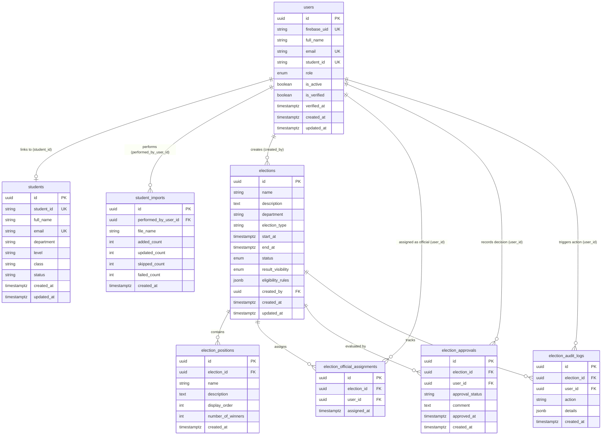

# DATABASE_SCHEMA.md — UniVote Relational Database Specification

This document details the relational data model for **UniVote**, derived directly from the authoritative SQLAlchemy models (`backend/app/models/`) and Alembic migrations (`backend/migrations/versions/`).

---

## 1. Entity Relationship Diagram

---

## 2. Table Specifications

### 2.1 `users`
Represents registered application user accounts. Passwords are handled exclusively by Firebase Authentication.

| Column | Type | Nullable | Default | Constraints & Indexes | Description |
|---|---|---|---|---|---|
| `id` | `UUID` | No | `gen_random_uuid()` | `PRIMARY KEY`, Index | Internal unique user identifier |
| `firebase_uid` | `VARCHAR(128)` | No | None | `UNIQUE`, Index | Authoritative Firebase Auth UID |
| `full_name` | `VARCHAR(255)` | No | None | None | Student / staff legal full name |
| `email` | `VARCHAR(320)` | No | None | `UNIQUE`, Index | University or personal registration email |
| `student_id` | `VARCHAR(50)` | Yes | `NULL` | `UNIQUE`, Index | Official student ID |
| `role` | `userrole` (ENUM) | No | `'STUDENT'` | None | Role: `STUDENT`, `ELECTION_OFFICIAL`, `SUPER_ADMIN` |
| `is_active` | `BOOLEAN` | No | `TRUE` | None | Account status; deactivated accounts cannot access API |
| `is_verified` | `BOOLEAN` | No | `FALSE` | Index | Verified against official student roster |
| `verified_at` | `TIMESTAMPTZ` | Yes | `NULL` | None | Timestamp of successful identity verification |
| `created_at` | `TIMESTAMPTZ` | No | `now()` | None | Record creation timestamp |
| `updated_at` | `TIMESTAMPTZ` | No | `now()` | None | Record last modified timestamp |

**Special Indexes (Migration `007_dashboard_stats_indexes`):**
- Partial Index: `ix_users_dashboard_registered_voters` on `(id)` `WHERE role = 'STUDENT' AND is_active = TRUE`.
- Partial Index: `ix_users_dashboard_verified_voters` on `(student_id)` `WHERE role = 'STUDENT' AND is_active = TRUE AND is_verified = TRUE`.

---

### 2.2 `students`
Authoritative university records imported from official CSV or Excel rosters.

| Column | Type | Nullable | Default | Constraints & Indexes | Description |
|---|---|---|---|---|---|
| `id` | `UUID` | No | `gen_random_uuid()` | `PRIMARY KEY`, Index | Internal record ID |
| `student_id` | `VARCHAR(50)` | No | None | `UNIQUE`, Index | Institutional student ID |
| `full_name` | `VARCHAR(255)` | Yes | `NULL` | None | Full legal name on institutional record |
| `email` | `VARCHAR(320)` | Yes | `NULL` | `UNIQUE`, Index | Official student email |
| `department` | `VARCHAR(255)` | Yes | `NULL` | None | Academic department / faculty |
| `level` | `VARCHAR(50)` | Yes | `NULL` | None | Academic level (e.g. 100, 200, 300, 400) |
| `class` | `VARCHAR(100)` | Yes | `NULL` | None | Assigned academic cohort / class |
| `status` | `VARCHAR(20)` | No | `'ACTIVE'` | Index | Status: `ACTIVE`, `INACTIVE`, `SUSPENDED`, `GRADUATED` |
| `created_at` | `TIMESTAMPTZ` | No | `now()` | None | Ingestion timestamp |
| `updated_at` | `TIMESTAMPTZ` | No | `now()` | None | Roster update timestamp |

**Composite Index:**
- `ix_students_dashboard_eligibility` on `(status, lower(department), student_id)`.

---

### 2.3 `student_imports`
Audit log tracking roster file upload operations.

| Column | Type | Nullable | Default | Constraints & Indexes | Description |
|---|---|---|---|---|---|
| `id` | `UUID` | No | `gen_random_uuid()` | `PRIMARY KEY` | Audit record identifier |
| `performed_by_user_id`| `UUID` | No | None | Index | Staff user ID who executed the import |
| `file_name` | `VARCHAR(255)` | No | None | None | Original upload filename |
| `added_count` | `INTEGER` | No | `0` | None | Count of newly inserted student records |
| `updated_count` | `INTEGER` | No | `0` | None | Count of existing records updated |
| `skipped_count` | `INTEGER` | No | `0` | None | Count of existing records skipped |
| `failed_count` | `INTEGER` | No | `0` | None | Count of failed / invalid rows |
| `created_at` | `TIMESTAMPTZ` | No | `now()` | None | Import completion timestamp |

---

### 2.4 `elections`
Electoral events, schedules, configuration settings, and stored eligibility rules.

| Column | Type | Nullable | Default | Constraints & Indexes | Description |
|---|---|---|---|---|---|
| `id` | `UUID` | No | `uuid.uuid4()` | `PRIMARY KEY`, Index | Unique election ID |
| `name` | `VARCHAR(255)` | No | None | None | Official election title |
| `description` | `TEXT` | Yes | `NULL` | None | Ballot description and instructions |
| `department` | `VARCHAR(150)` | No | `'Computer Science and Engineering'` | Index | Sponsoring department |
| `election_type` | `VARCHAR(100)` | No | `'Departmental Election'` | None | Scope (Departmental, SRC, Faculty) |
| `start_at` | `TIMESTAMPTZ` | Yes | `NULL` | None | Voting commencement timestamp |
| `end_at` | `TIMESTAMPTZ` | Yes | `NULL` | None | Voting conclusion timestamp |
| `status` | `electionstatus` (ENUM) | No | `'DRAFT'` | Index | Status: `DRAFT`, `PENDING_APPROVAL`, `OFFICIAL_REVIEW`, `SUPER_ADMIN_FINAL_APPROVAL`, `APPROVED`, `SCHEDULED`, `LIVE`, `ENDED`, `CANCELLED` |
| `result_visibility` | `resultvisibility` (ENUM)| No | `'OFFICIALS_ONLY_DURING_VOTING'`| None | Visibility: `HIDDEN_UNTIL_ENDED`, `OFFICIALS_ONLY_DURING_VOTING`, `PUBLIC_LIVE` |
| `eligibility_criteria`| `JSONB` | No | `'{}'` | None | Filter rules (`{"departments": [...], "levels": [...]}`) |
| `created_by` | `UUID` | No | None | `FOREIGN KEY (users.id)`, Index | Creator user ID |
| `created_at` | `TIMESTAMPTZ` | No | `now()` | None | Creation timestamp |
| `updated_at` | `TIMESTAMPTZ` | No | `now()` | None | Last modified timestamp |

---

### 2.5 `election_positions`
Offices and positions contested within an election.

| Column | Type | Nullable | Default | Constraints & Indexes | Description |
|---|---|---|---|---|---|
| `id` | `UUID` | No | `uuid.uuid4()` | `PRIMARY KEY`, Index | Unique position ID |
| `election_id` | `UUID` | No | None | `FOREIGN KEY (elections.id) ON DELETE CASCADE`, Index | Parent election ID |
| `name` | `VARCHAR(150)` | No | None | None | Position name (e.g., President) |
| `description` | `TEXT` | Yes | `NULL` | None | Position duties and criteria |
| `display_order` | `INTEGER` | No | `0` | None | Display sort order on ballot |
| `number_of_winners` | `INTEGER` | No | `1` | None | Number of seats available |
| `created_at` | `TIMESTAMPTZ` | No | `now()` | None | Creation timestamp |

---

### 2.6 `election_official_assignments`
Junction table tracking staff assigned to manage specific elections.

| Column | Type | Nullable | Default | Constraints & Indexes | Description |
|---|---|---|---|---|---|
| `id` | `UUID` | No | `uuid.uuid4()` | `PRIMARY KEY`, Index | Assignment ID |
| `election_id` | `UUID` | No | None | `FOREIGN KEY (elections.id) ON DELETE CASCADE`, Index | Assigned election |
| `user_id` | `UUID` | No | None | `FOREIGN KEY (users.id) ON DELETE CASCADE`, Index | Staff user |
| `assigned_at` | `TIMESTAMPTZ` | No | `now()` | None | Assignment timestamp |

**Constraint**: `UNIQUE (election_id, user_id)` (prevents duplicate assignments).

---

### 2.7 `election_approvals`
Audit records of review decisions across the multi-stage election workflow.

| Column | Type | Nullable | Default | Constraints & Indexes | Description |
|---|---|---|---|---|---|
| `id` | `UUID` | No | `uuid.uuid4()` | `PRIMARY KEY`, Index | Approval entry ID |
| `election_id` | `UUID` | No | None | `FOREIGN KEY (elections.id) ON DELETE CASCADE`, Index | Target election |
| `user_id` | `UUID` | No | None | `FOREIGN KEY (users.id) ON DELETE CASCADE`, Index | Reviewer user |
| `approval_status` | `VARCHAR(50)` | No | None | None | Decision: `APPROVED`, `REJECTED`, `REQUESTED_CHANGES` |
| `comment` | `TEXT` | Yes | `NULL` | None | Optional reviewer commentary |
| `approved_at` | `TIMESTAMPTZ` | Yes | `NULL` | None | Decision timestamp |
| `created_at` | `TIMESTAMPTZ` | No | `now()` | None | Record created timestamp |

---

### 2.8 `election_audit_logs`
Immutable ledger capturing all election modifications, status transitions, and administrative actions.

| Column | Type | Nullable | Default | Constraints & Indexes | Description |
|---|---|---|---|---|---|
| `id` | `UUID` | No | `uuid.uuid4()` | `PRIMARY KEY`, Index | Log entry ID |
| `election_id` | `UUID` | No | None | `FOREIGN KEY (elections.id) ON DELETE CASCADE`, Index | Associated election |
| `user_id` | `UUID` | Yes | `NULL` | `FOREIGN KEY (users.id) ON DELETE SET NULL`, Index | Actor user |
| `action` | `VARCHAR(100)` | No | None | Index | Action name (e.g. `CREATED`, `UPDATED`, `SUBMITTED`) |
| `details` | `JSONB` | Yes | `NULL` | None | Snapshot of modified fields or diffs |
| `created_at` | `TIMESTAMPTZ` | No | `now()` | Index | Event occurrence timestamp |

---

## 3. Key Relationships & Identity Integrity Rules

1. **Firebase UID to User Mapping**: `User.firebase_uid` is the authoritative link between Firebase Authentication and PostgreSQL. It is marked `UNIQUE` and `NOT NULL`.
2. **Official Roster Linkage**: `User.student_id` is an optional unique reference that pairs the application account with a record in `students.student_id`.
3. **Identity Verification Rule**: Verification sets `User.is_verified = True` only when:
   - `User.student_id == Student.student_id`
   - `Student.status == 'ACTIVE'`
   - `normalize_name(User.full_name) == normalize_name(Student.full_name)`
   - `lower(User.email) == lower(Student.email)`
4. **Election Referential Integrity**: Deleting an election cascades deletion to `election_positions`, `election_official_assignments`, `election_approvals`, and `election_audit_logs`. Users linked as creators (`created_by`) are protected by `ON DELETE RESTRICT`.
