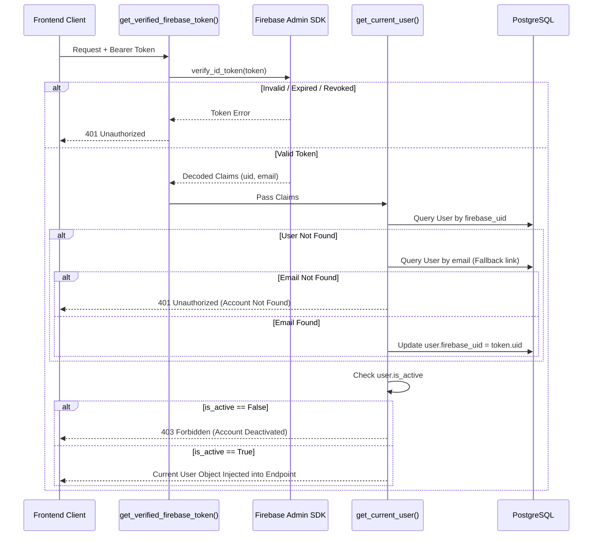

# AUTHENTICATION.md — Authentication & Firebase Integration Guide

## 1. Overview

UniVote relies on **Firebase Authentication** for identity management. The client authenticates against Firebase to receive a JWT ID token, which is passed in the `Authorization` header to FastAPI for server-side verification.

## 2. Authentication Methods

1. **Email / Password**:
   - Client uses `createUserWithEmailAndPassword()` and `signInWithEmailAndPassword()`.
   - Requires email verification before accessing protected student/staff features.
2. **Google OAuth**:
   - Client triggers `signInWithPopup(auth, googleProvider)`.
   - Returns verified email and profile name directly from Google.
3. **Password Reset**:
   - Client triggers `sendPasswordResetEmail()` via Firebase.

## 3. Token Verification Pipeline

Every authenticated request sent from the frontend includes:
```http
Authorization: Bearer <FIREBASE_ID_TOKEN>
```

FastAPI processes the token using dependencies defined in `backend/app/auth/dependencies.py`:



## 4. Account Synchronization (`POST /api/auth/sync`)

Immediately upon sign-in or registration, the frontend calls `POST /api/auth/sync`:
- Checks if a `User` record exists for the given `firebase_uid`.
- If missing, creates a new `User` entity with:
  - `role = UserRole.STUDENT`
  - `is_active = True`
  - `is_verified = False`
- Prevents role spoofing: registration inputs cannot supply a custom role.
