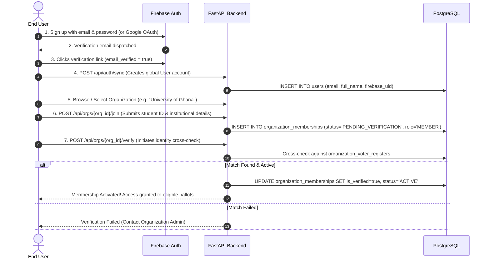
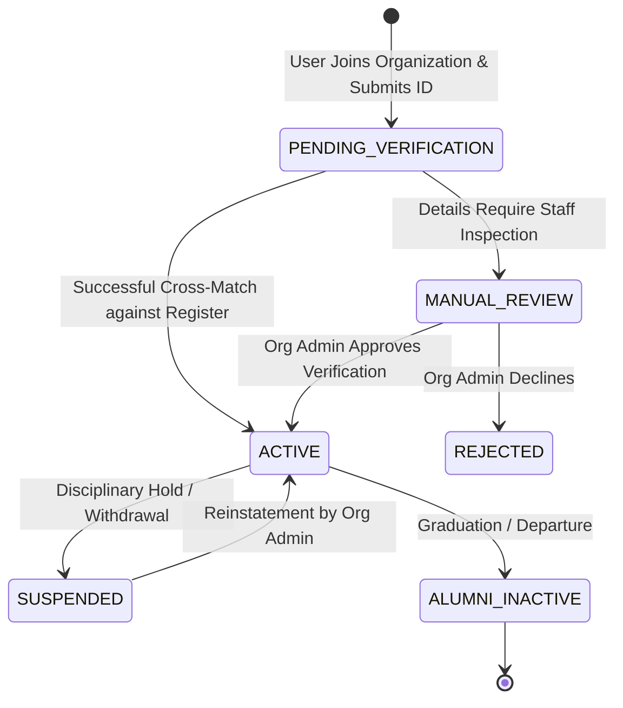

# AUTH_AND_MEMBERSHIP.md — Universal Accounts & Organization Membership

This document specifies the authentication mechanics, registration flows, and multi-organization membership lifecycle in **UniVote**.

---

## 1. Universal Accounts vs. Organization Memberships

UniVote enforces a fundamental separation between platform identity and institutional membership:

| Concept | Scope | Stored Entity | Key Attributes |
|---|---|---|---|
| **User Account** | Global / Platform | `users` | `firebase_uid`, `email`, `full_name`, `is_platform_super_admin`, `is_active` |
| **Organization** | Tenant | `organizations` | `name`, `slug`, `status`, `settings` |
| **Organization Membership**| Tenant-Specific | `organization_memberships` | `organization_id`, `user_id`, `member_identifier`, `role`, `department`, `status`, `is_verified` |
| **Voter Eligibility** | Event / Ballot | Evaluated dynamically | Criteria matching based on membership attributes or uploaded registers |

> **Important**: Email verification establishes only that the user owns their email address. It does **not** grant institutional membership or voting rights.

---

## 2. Universal Registration & Onboarding Lifecycle

---

## 3. Membership States

Every user's relationship with an organization progresses through explicit states:

- **`PENDING_VERIFICATION`**: User joined the organization; automated cross-matching against the uploaded register is in progress.
- **`ACTIVE`**: Identity verified. User may access member quick polls and check formal election eligibility.
- **`MANUAL_REVIEW`**: Slight name mismatches or special enrollment statuses escalated to the Organization Admin.
- **`SUSPENDED`**: Member temporarily barred from voting or participating.
- **`ALUMNI_INACTIVE`**: Retains historical audit participation without active voting privileges.

---

## 4. Multi-Organization Switching

A user may belong to multiple organizations concurrently (e.g. a student enrolled at a University who is also an executive member of an Engineering Association):
- The client UI provides an **Organization Switcher**.
- The frontend tracks the active tenant (`currentOrgId`) and attaches the `X-Organization-ID` header to all API requests.
- The user's role and capabilities adapt automatically to their specific assigned role within that tenant.
