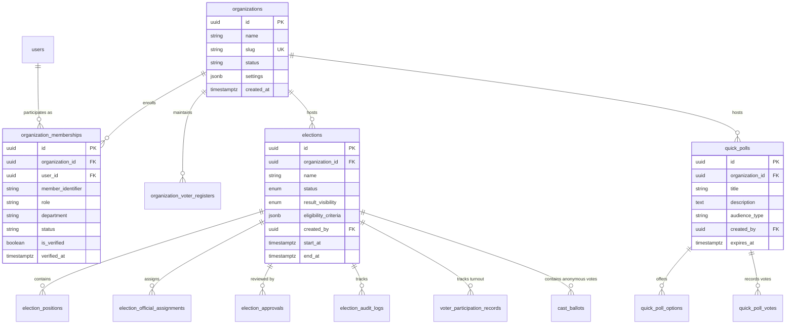

# DATABASE_ARCHITECTURE.md — Multi-Tenant Database Design

This document details the relational data model, tenant isolation strategy, entity definitions, and migration roadmap for **UniVote**.

---

## 1. Multi-Tenant Relational Schema Diagram



---

## 2. Table Specifications & Entities

### 2.1 Target Multi-Tenant Entities

#### `organizations` (Foundation implemented)
Represents organization tenants. Alembic `0002_organization_foundation` creates a UUID `id`, `name`, unique `slug`, optional `description`, `organization_type`, optional `logo_url` / `contact_email` / `website`, `country`, lifecycle `status`, required `created_by`, optional `approved_by` / `approved_at`, and timestamps. Branding settings and tenant operational features remain future work.

#### `organization_requests` (Foundation implemented)
Stores authenticated organization submissions separately from organizations, including profile details, optional supporting information, requester/reviewer references, pending/approved/rejected status, rejection reason, resulting organization, and timestamps.

#### `organization_management_assignments` and `organization_audit_logs` (Foundation implemented)
Assignments store a user, organization, and `ORGANISATION_OWNER` / `ORGANISATION_ADMIN` role, with at most one owner per organization. Audit logs record organization onboarding, management, and lifecycle actions. These tables do not implement general membership.

---

### 2.2 Active Prototype Tables & Status

| Table Name | Prototype Status | Target Schema Migration Plan |
|---|---|---|
| **`users`** | Implemented. Fields include UUID `id`, unique `firebase_uid`, unique normalized `email`, `full_name`, `is_active`, `is_platform_super_admin`, and timestamps. | Preserve universal identity; tenant management assignments are stored separately. |
| **`students`, `student_imports`, election tables** | Existing prototype/application data; not part of this migration. | Organization scoping and authorization are future work. |
| **`quick_polls`** | Planned (Not in codebase). | New table with `organization_id`, `audience_type`, and expiry. |
| **`quick_poll_options`** | Planned (Not in codebase). | New table for poll voting choices/nominees. |
| **`voter_participation_records`** | Planned (Not in codebase). | Tracks turnout per voter per position (prevents duplicate voting). |
| **`cast_ballots`** | Planned (Not in codebase). | Anonymized secret ballot selections decoupled from voter IDs. |

---

## 3. Database Connection & Pooling Architecture

- **Stage 1 runtime driver**: SQLAlchemy with `psycopg[binary]`.
- **Neon URL**: The backend accepts a PostgreSQL URL and normalizes `postgres://` or `postgresql://` to `postgresql+psycopg://`.
- **Connection Configuration** (`backend/app/database/session.py`):
  ```python
  engine = create_engine(
      get_database_url(),
      pool_pre_ping=True,
  )
  sessionmaker(bind=engine, autoflush=False, expire_on_commit=False)
  ```
- **Session Management**: Dependency-injected synchronous SQLAlchemy sessions close after each request. Profile synchronization and updates are committed transactionally.
- **Migrations**: Alembic revisions `0001_create_users` and `0002_organization_foundation` define the current user and organization foundation.

---

## 4. Current migration state

The current revision chain is `0001_create_users` → `0002_organization_foundation`. The latter adds organization requests, organizations, management assignments, organization audit records, and the default-false `users.is_platform_super_admin` flag. It does not create memberships, legacy tenants, student/register tables, or election foreign keys.

The migration has been rendered offline and the API tested with isolated SQLite. It has not been applied to Neon. Review it against an approved non-production Neon branch before applying; use a direct (non-pooler) connection for Alembic and do not test migrations against production.
