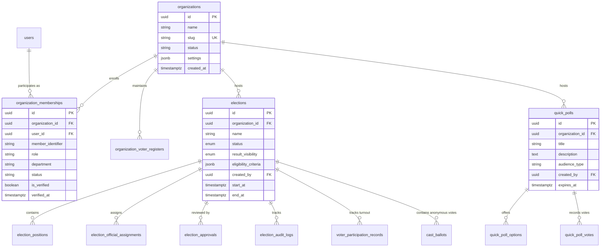

# DATABASE_ARCHITECTURE.md — Multi-Tenant Database Design

This document details the relational data model, tenant isolation strategy, entity definitions, and migration roadmap for **UniVote**.

---

## 1. Multi-Tenant Relational Schema Diagram



---

## 2. Table Specifications & Entities

### 2.1 Target Multi-Tenant Entities

#### `organizations` (Target Model)
Represents independent organizational tenants.
- `id`: `UUID PRIMARY KEY DEFAULT gen_random_uuid()`
- `name`: `VARCHAR(255) NOT NULL` (e.g. "University of Ghana")
- `slug`: `VARCHAR(100) UNIQUE NOT NULL` (e.g. "ug-legon")
- `logo_url`: `VARCHAR(500) NULL`
- `status`: `VARCHAR(50) NOT NULL DEFAULT 'ACTIVE'` (`PENDING_REVIEW`, `ACTIVE`, `SUSPENDED`, `ARCHIVED`)
- `settings`: `JSONB NOT NULL DEFAULT '{}'::jsonb` (Domain allowlists, branding, custom fields)
- `created_at`: `TIMESTAMPTZ NOT NULL DEFAULT now()`

#### `organization_memberships` (Target Model)
Decouples user identity from institutional membership.
- `id`: `UUID PRIMARY KEY DEFAULT gen_random_uuid()`
- `organization_id`: `UUID NOT NULL REFERENCES organizations(id) ON DELETE CASCADE`
- `user_id`: `UUID NOT NULL REFERENCES users(id) ON DELETE CASCADE`
- `member_identifier`: `VARCHAR(100) NULL` (Student ID, Staff ID, Employee Number)
- `role`: `VARCHAR(50) NOT NULL DEFAULT 'MEMBER'` (`ORGANIZATION_ADMIN`, `ELECTION_OFFICIAL`, `ELECTION_SUPER_ADMIN`, `MEMBER`, `POLL_CREATOR`)
- `department`: `VARCHAR(255) NULL`
- `level`: `VARCHAR(50) NULL`
- `status`: `VARCHAR(50) NOT NULL DEFAULT 'PENDING_VERIFICATION'` (`PENDING_VERIFICATION`, `ACTIVE`, `MANUAL_REVIEW`, `SUSPENDED`, `ALUMNI_INACTIVE`)
- `is_verified`: `BOOLEAN NOT NULL DEFAULT FALSE`
- `verified_at`: `TIMESTAMPTZ NULL`
- **Constraint**: `UNIQUE (organization_id, user_id)`

#### `organization_voter_registers` (Target Model — Evolution of `students`)
Stores authoritative pre-imported rosters per tenant.
- `id`: `UUID PRIMARY KEY DEFAULT gen_random_uuid()`
- `organization_id`: `UUID NOT NULL REFERENCES organizations(id) ON DELETE CASCADE`
- `member_identifier`: `VARCHAR(100) NOT NULL` (Institutional ID)
- `full_name`: `VARCHAR(255) NULL`
- `email`: `VARCHAR(320) NULL`
- `department`: `VARCHAR(255) NULL`
- `level`: `VARCHAR(50) NULL`
- `class`: `VARCHAR(100) NULL`
- `status`: `VARCHAR(20) NOT NULL DEFAULT 'ACTIVE'`
- **Constraint**: `UNIQUE (organization_id, member_identifier)`

---

### 2.2 Active Prototype Tables & Status

| Table Name | Prototype Status | Target Schema Migration Plan |
|---|---|---|
| **`users`** | Exists (Single-tenant). Has `firebase_uid`, `email`, `role`, and `student_id`. | Remove `student_id`; replace `role` with `is_platform_super_admin: bool`. Move operational roles into `organization_memberships`. |
| **`students`** | Exists (Single-tenant roster). | Scope to `organization_id` and evolve into `organization_voter_registers`. |
| **`student_imports`** | Exists. Tracks roster import history. | Add `organization_id UUID NOT NULL REFERENCES organizations(id)`. |
| **`elections`** | Exists (Wizard configuration). Has status and eligibility JSONB. | Add `organization_id UUID NOT NULL REFERENCES organizations(id)`. |
| **`election_positions`** | Exists. Contested positions and winner counts. | Retain foreign key to `elections.id`. Add position eligibility overrides. |
| **`election_official_assignments`** | Exists. Junction of users to elections. | Refactor `user_id` to link to `organization_memberships.id`. |
| **`election_approvals`** | Exists. Approval status and reviewer comments. | Retain review tracking; link to tenant context. |
| **`election_audit_logs`** | Exists (Migration 009). Immutable action ledger. | Retain; add `organization_id` for tenant-wide event streaming. |
| **`quick_polls`** | Planned (Not in codebase). | New table with `organization_id`, `audience_type`, and expiry. |
| **`quick_poll_options`** | Planned (Not in codebase). | New table for poll voting choices/nominees. |
| **`voter_participation_records`** | Planned (Not in codebase). | Tracks turnout per voter per position (prevents duplicate voting). |
| **`cast_ballots`** | Planned (Not in codebase). | Anonymized secret ballot selections decoupled from voter IDs. |

---

## 3. Database Connection & Pooling Architecture

- **Driver**: `postgresql+asyncpg` for FastAPI runtime async execution; `psycopg2-binary` for synchronous Alembic migrations.
- **Connection Configuration** (`backend/app/database/session.py`):
  ```python
  engine = create_async_engine(
      settings.async_database_url,
      connect_args={"ssl": True},
      pool_pre_ping=True,
      pool_size=5,
      max_overflow=5,
      pool_recycle=1800,
  )
  ```
- **Session Management**: Fast, non-blocking async session yielding via `get_db()` with automatic commit and rollback handling.
