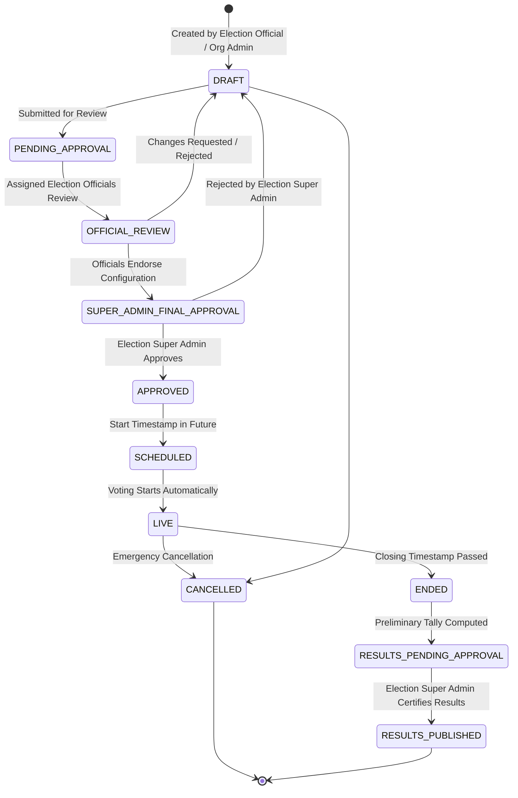

# FORMAL_ELECTIONS.md — Formal Election Lifecycle & Voting Workflow

This document specifies the architecture, candidate management, balloting mechanics, and approval sequence for **Formal Elections** in UniVote.

---

## 1. Formal Election Lifecycle

Formal elections follow an auditable status state machine:

---

## 2. Positions, Contested Offices & Voter Eligibility

- **Multi-Position Structure**: An election can contain one or more contested offices (e.g., President, General Secretary, Welfare Officer) managed via `election_positions`.
- **Display Ordering**: Contested offices are arranged by explicit `display_order` on the ballot paper.
- **Winners Count (`number_of_winners`)**: Supports single-winner offices (e.g., President, `number_of_winners = 1`) and multi-seat bodies (e.g., Executive Committee, `number_of_winners = 3`).
- **Eligibility Inheritance & Overrides**:
  - By default, positions inherit the election's master voter eligibility criteria (`Election.eligibility_criteria`).
  - **Position-Specific Overrides**: An individual position can override criteria to restrict voting to a subset of members (e.g., "Engineering Faculty Rep" restricted to Engineering students).

---

## 3. Candidate Nomination & Vetting

1. **Nomination Filing**: Members submit applications for approved positions, uploading bios, photos, and platform manifestos.
2. **Official Vetting**: Assigned Election Officials inspect candidate academic/disciplinary standing, verify qualifications, and approve or reject nominations.
3. **Ballot Placement**: Only vetted candidates appear on the published ballot.

---

## 4. First-Past-The-Post (FPTP) Balloting & Vote Editing

- **One Vote per Position**: A voter may select up to `number_of_winners` candidates per office.
- **Optional Blank Votes**: Voters can select "Abstain / None of the Above" for any contested office.
- **Vote Editing Before Closure**: While an election is `LIVE`, voters may reopen their ballot, adjust their selections, and re-submit. Their earlier anonymous ballot is superseded without compromising ballot secrecy.
- **Permanent Sealing**: Once the election closing timestamp (`end_at`) passes, all ballots are sealed against modification.

---

## 5. Result Verification & Multi-Tier Approvals

1. **Preliminary Counting**: The backend calculates aggregate vote tallies upon election closure.
2. **Election Official Inspection**: Assigned Election Officials review voter turnout, check for statistical anomalies, and submit their evaluation.
3. **Election Super Admin Final Certification**: The Election Super Admin reviews the audit trail and formally certifies results (`POST /api/elections/{id}/final-approve`), releasing results to voters and the public.
