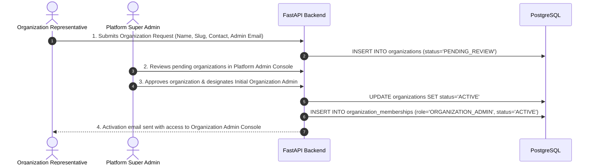

# ORGANIZATION_MANAGEMENT.md — Tenant Governance & Administration

This document defines the organization lifecycle, administrative workflows, and delegation tools in **UniVote**.

---

## 1. Organization Onboarding Lifecycle

The onboarding of a new organization follows a managed verification process:

---

## 2. Organization Admin Responsibilities

Once activated, the **Organization Admin** manages all day-to-day operations:

### 2.1 Institutional Profile & Branding
- Organization display name, slug, official logo URL, and primary branding colors.
- Custom institutional fields (e.g. "Faculty", "Campus Location", "Admission Cohort").
- Institutional verification policies (e.g. allowed email domain patterns such as `@st.ug.edu.gh`).

### 2.2 Departments & Membership Groups
- Creation and management of academic departments, colleges, student clubs, or business units.
- Group hierarchies used for targeted voter eligibility filtering.

### 2.3 Voter Register & Roster Ingestion
- Uploading and updating official rosters via `.csv` or `.xlsx` spreadsheets.
- Reviewing dry-run import previews, duplicate detection flags, and syntax errors.
- Committing validated rosters to `organization_voter_registers`.

### 2.4 Staff Delegations & Role Assignments
- Appointing **Election Officials** to configure and supervise formal elections.
- Designating the **Election Super Admin** for result certification.
- Granting **Poll Creator** privileges to authorized members, course reps, or club executives.
- Resolving escalated identity mismatches in `MANUAL_REVIEW`.
