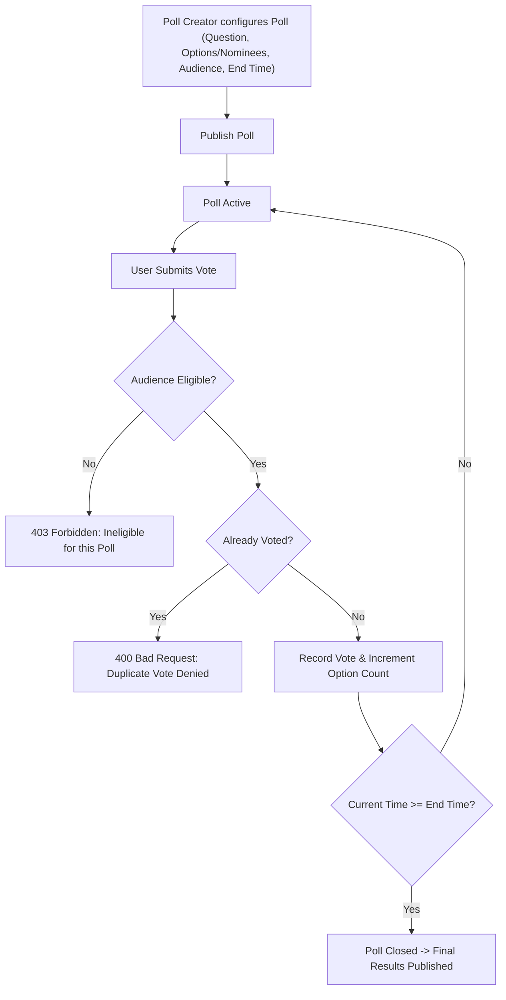

# QUICK_POLLS.md — Informal Quick Polls Specification

This document specifies the informal **Quick Polls** module in **UniVote**, outlining poll creation, audience targeting, anti-duplication safeguards, and automated results.

---

## 1. Overview & Formal Elections Comparison

Quick Polls provide an agile voting capability for campus engagement, student awards, social pulse checks, and event choices without formal electoral commission bureaucracy.

| Feature | Formal Elections | Quick Polls |
|---|---|---|
| **Primary Purpose** | Regulated constitutional officer elections | Engagement polls, awards, pulse surveys |
| **Roster Ingestion** | Mandatory CSV/XLSX official register import | Zero roster ingestion; reuses verified memberships |
| **Contested Offices** | Multiple positions per election | Single question with options/nominee cards |
| **Creator Role** | Election Officials / Organization Admins | Poll Creators (appointed by Org Admin) |
| **Approval Pipeline**| Multi-stage sign-off (`DRAFT` → `REVIEW` → `SUPER_ADMIN`) | Instant publish or scheduled release without approvals |
| **Vote Modification**| Vote editing allowed before election close | Single immutable submission per voter |
| **Result Release** | Certified by Election Super Admin | Instant real-time or auto-released upon poll close |

---

## 2. Audience Targeting Modes

Quick Polls support three flexible audience modes:

1. **`PUBLIC` Audience**:
   - Open to all site visitors (including unauthenticated users).
   - Protected using client browser fingerprinting, IP rate-limiting, and bot challenges.
   - Use case: Campus open day awards, prospective student polls.
2. **`ORGANIZATION_MEMBERS` Audience**:
   - Restricted to authenticated users holding an active verified membership in the hosting organization.
   - Reuses existing verified membership without requiring a separate spreadsheet upload.
   - Use case: "Favorite Lecturer", "Best Dressed Student", "Annual Dinner Venue".
3. **`RESTRICTED_GROUP` Audience**:
   - Restricted to specific sub-groups within the organization (e.g. Computer Science Department, Level 300).
   - Use case: Class representative straw polls, project topic selections.

---

## 3. Poll Lifecycle & Anti-Duplication Controls

- **Duplicate Prevention**: For member and restricted audience polls, the system records participation keyed to `(poll_id, user_id)`. For public polls, anti-duplication uses client fingerprints, IP subnet tracking, and rate limits.
- **Automated Results**: Results can display live in real-time or remain sealed until the scheduled poll conclusion.
