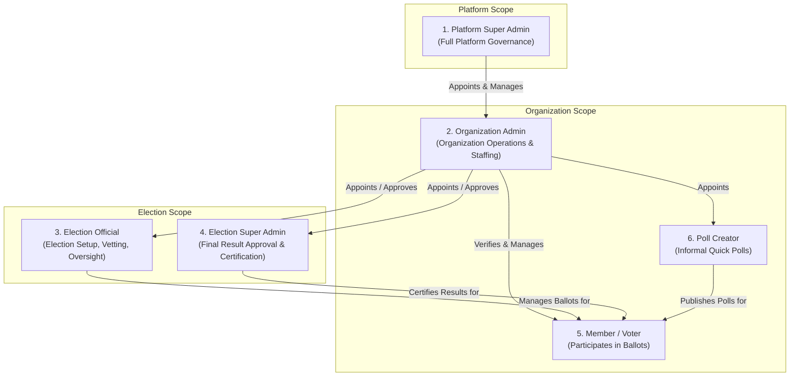

# ROLES_AND_PERMISSIONS.md — Scoped Role & Authority Specification

This document describes the intended UniVote role scopes and distinguishes the implemented organization-management foundation from future roles. The current backend implements only Platform Super Admin and organization owner/admin assignment foundations; election, member, and poll permissions are not implemented.

---

## 1. Six Scoped Roles Overview

UniVote structures authority across three distinct scopes: **Platform**, **Organization**, and **Election**:

---

## 2. Role Specification Matrix

| Role | Scope | Authority & Core Responsibilities | Appointment Mechanism |
|---|---|---|---|
| **1. Platform Super Admin** | Global / Platform | Oversees global infrastructure, reviews and approves new organizations, assigns initial Organization Admins, and audits cross-tenant activities. | Direct database provisioning or internal platform governance. |
| **2. Organization Owner / Admin** | Organization | Current backend assignment foundation only. Owner/admin assignments are not a general membership system; organization administration workflows beyond the foundation remain future work. | Initial owner is assigned on approval/direct creation; no general delegation endpoint exists yet. |
| **3. Election Official** | Specific Election / Org | Configures formal elections, sets up contested positions, vets candidate nominations, monitors live turnout, and conducts preliminary review of tallies. | Assigned by Organization Admin to specific election(s). |
| **4. Election Super Admin** | Specific Election / Org | Holds final certification authority. Reviews election audit trails, signs off on preliminary tallies, approves or rejects results, and certifies public release. | Assigned by Organization Admin or Institutional Returning Officer. |
| **5. Member / Voter** | Organization | Enrolled organizational member. Verifies identity against the institutional register, browses elections/polls, checks eligibility, and casts secret ballots. | Self-registration followed by institutional verification. |
| **6. Poll Creator** | Organization | Authorized member or staff member allowed to configure and publish lightweight informal Quick Polls (e.g. Best Lecturer, Club Awards). | Granted permission by Organization Admin. |

---

## 3. Disambiguation Rules

To eliminate role confusion in implementation and audit trails:

1. **Platform Super Admin vs. Election Super Admin**:
   - The **Platform Super Admin** oversees server infrastructure, system uptime, and tenant onboarding across the entire platform.
   - The **Election Super Admin** is an institutional authority (such as an Electoral Commissioner or Dean of Students) whose sole jurisdiction is giving final approval to election results within their organization.
2. **Organization Admin vs. Election Official**:
   - The **Organization Admin** manages institutional operations, voter registers, and member rosters.
   - The **Election Official** has operational oversight of an individual election, its candidates, and ballot setups.
3. **Members vs. Eligible Voters**:
   - A **Member** is a verified user belonging to an organization.
   - An **Eligible Voter** is a member who satisfies the specific criteria (department, cohort, level) established for a given ballot.

---

## 4. Authorization Enforcement

Implemented permissions are centrally registered in `backend/app/auth/permissions.py` and checked in FastAPI:

- Platform administration requires `is_platform_super_admin == True`.
- Organization detail access requires platform authority or an organization assignment.
- Active/revoked organization and platform role assignments are stored separately from Firebase identity.
- Platform role assignments do not automatically grant organization roles.
- Organization roles do not grant platform administration.
- Frontend navigation reflects database-backed profile role state only for usability; backend dependencies remain authoritative.

Election, membership, and poll authorization rules above remain target concepts and are not yet enforced by application modules.
