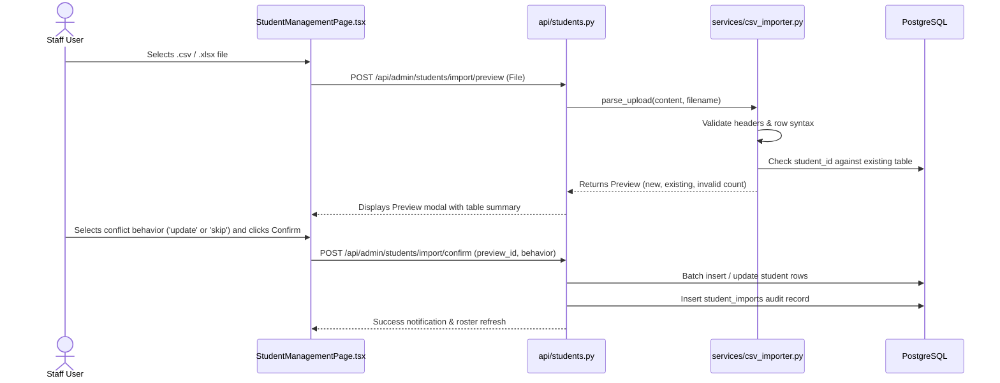

# STUDENT_IMPORT.md — Official Student Roster Ingestion Guide

## 1. Overview

UniVote allows election officials and administrators to upload official university student rosters using `.csv` or `.xlsx` files. This populates the authoritative `students` table used for identity verification and voter eligibility checks.

## 2. File Format & Schema Requirements

The uploaded file must contain a header row with the following required columns (case-insensitive and whitespace-tolerant):

| Required Header | Alternate Formats | Target Field | Example Value |
|---|---|---|---|
| `student_id` | `Student ID`, `STUDENT_ID` | `students.student_id` | `10987654` |
| `full_name` | `Full Name`, `FULL_NAME` | `students.full_name` | `Kofi Mensah` |
| `email` | `Email`, `EMAIL` | `students.email` | `kmensah@st.ug.edu.gh` |
| `department` | `Department` | `students.department` | `Computer Science and Engineering` |
| `level` | `Level` | `students.level` | `300` |
| `class` | `Class` | `students.class` | `Level 300 CE` |
| `status` | `Status` | `students.status` | `ACTIVE` |

## 3. Two-Phase Ingestion Workflow

## 4. Conflict Handling & Audit Logging

- **`update`**: Updates existing students' academic records (`department`, `level`, `class`, `status`, `full_name`).
- **`skip`**: Leaves existing student records unchanged, inserting only new entries.
- **Audit Logging**: Every confirmed import records a row in `student_imports` tracking:
  - Performing staff user ID (`performed_by_user_id`).
  - Source filename (`file_name`).
  - Counts: `added_count`, `updated_count`, `skipped_count`, `failed_count`.
