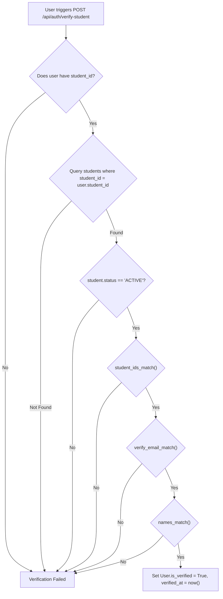

# STUDENT_VERIFICATION.md — Student Identity Verification Guide

## 1. Overview

**Student Identity Verification** is the process by which an application user account proves that it belongs to an authentic, enrolled student at the university.

Identity verification is independent of election eligibility:
- **Verification**: *"Is this user a verified student at this institution?"*
- **Eligibility**: *"Is this verified student allowed to vote in this particular election?"*

## 2. Multi-Factor Comparison Algorithm

Verification is performed by `compare_identity()` (`backend/app/services/student_verification.py`):



## 3. Matching Rules (`services/identity.py`)

1. **Student ID Matching (`student_ids_match`)**:
   - Both IDs are stripped of whitespace and capitalized:
     ```python
     normalize_student_id(id1) == normalize_student_id(id2)
     ```
2. **Email Matching (`verify_email_match`)**:
   - Comparison is trimmed and case-insensitive:
     ```python
     email1.strip().lower() == email2.strip().lower()
     ```
3. **Name Matching (`names_match`)**:
   - Leading/trailing whitespace is stripped.
   - Internal consecutive spaces, tabs, or newlines are collapsed into a single space.
   - Case-insensitive comparison:
     ```python
     "  Kofi   Mensah  " -> "kofi mensah"
     ```

## 4. Security & Audit Considerations

- **Probing Defense**: When verification fails, the API returns a generic error: `"Student verification failed. Details do not match official records."` The exact reason (`name_mismatch`, `email_mismatch`, `student_record_not_found`) is logged server-side for audit purposes only and is never disclosed to the client.
- **Verification Invalidation**: If a verified user changes their `student_id` via `PATCH /api/auth/me`, the backend automatically resets `is_verified = False` and `verified_at = None`, requiring re-verification.
