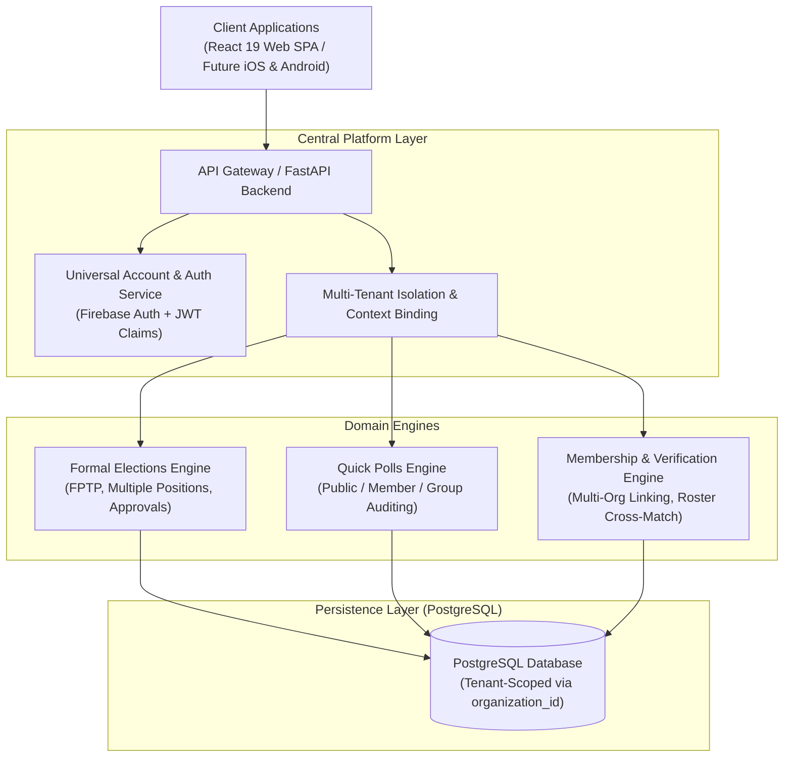

# SYSTEM_ARCHITECTURE.md — Multi-Tenant System Architecture

This document specifies the target multi-tenant system architecture of **UniVote**, outlining the structural transition from the prototype to a multi-organization voting and polling platform.

## Stage 1 implementation status

The current implementation establishes only the universal authentication foundation:

- React + TypeScript + Vite owns Firebase login UI and browser session restoration.
- FastAPI verifies Firebase ID tokens and email-verification claims.
- SQLAlchemy and Alembic manage the Neon PostgreSQL `users` table.
- Profile synchronization and profile updates are the only implemented application API operations.
- Organizations, memberships, elections, polls, voting, and tenant authorization are not implemented in this stage.

---

## 1. Architectural Vision & Scope

UniVote is an organizational voting platform serving diverse membership-based bodies:
- **Universities & Colleges**: Student Representative Council (SRC) ballots, faculty boards, course representative voting.
- **Academic Departments**: Departmental executive elections, committee polls.
- **Student Associations & Clubs**: Sports clubs, debate societies, student unions.
- **Companies & Corporate Boards**: Staff representatives, shareholder and board resolutions.
- **Professional Associations & Trade Unions**: Executive officer elections, constitution ratifications.

The target is for each organization to operate as an independent tenant within shared infrastructure. The source code has tenant-scoped models, request context, and authorization paths, but full isolation has not been validated against an isolated database and API test environment.

**Implementation note:** This document distinguishes the target architecture from current source behavior. Do not treat the target diagrams or invariants below as proof of deployed schema or end-to-end security.



---

## 2. Multi-Tenant Architectural Topology

UniVote is designed for a **Shared Database, Shared Schema with tenant ownership**. In the current source:
- Tenant ownership is represented directly or through parent relationships; not every tenant-related table has its own `organization_id` column, and delete behavior varies by relationship.
- Tenant-aware routes require an `X-Organization-ID` identifying an active organization. This selects context but does not grant access; membership/platform authorization must still be checked.
- The legacy default-organization fallback was removed. Missing or malformed context is rejected by the shared dependency.
- Some request/service paths scope queries and writes to the selected tenant, but source inspection and unit tests do not establish end-to-end tenant isolation. Database-backed integration verification remains outstanding.

### Logical Separation of Tenancy Boundaries:
1. **Platform Scope**: Platform Super Admins oversee platform uptime, organization creation, system-wide configuration, and global audit streams.
2. **Organization Scope**: Organization Admins configure membership groups, custom fields, verification rosters, Election Officials, and Poll Creators.
3. **Event Scope (Election / Poll)**: Scoped to specific elections or polls, governing ballot access, candidate nomination, voter eligibility, and result sign-off.

---

## 3. Core Subsystems & Interaction Patterns

```mermaid
sequenceDiagram
    autonumber
    actor User as User (Universal Account)
    participant Web as React Web SPA
    participant API as FastAPI Backend
    participant Tenant as Tenant Isolation Middleware
    participant Engine as Election / Poll Engine
    participant DB as PostgreSQL

    User->>Web: Selects Organization & Event
    Web->>API: HTTP Request + Firebase Bearer Token + X-Organization-ID
    API->>API: Verify Firebase token and email_verified claim
    API->>Tenant: Resolve active organization; check scoped role/status
    Tenant->>DB: Load membership for user_id + organization_id
    alt Missing, pending, suspended, or insufficient role
        Tenant-->>Web: Reject request according to route policy
    else Authorized by route policy
        Tenant->>Engine: Forward with selected organization context
        Engine->>DB: Execute tenant-scoped operation
        DB-->>Engine: Matching records
        Engine-->>Web: Response payload
    end
```

This sequence is an intended request pattern, not a blanket guarantee for every endpoint. Confirm each route and query individually; database/API integration tests are still required.

---

## 4. Current Prototype vs. Target Architecture

| Component | Current Prototype Implementation | Target Multi-Tenant Architecture |
|---|---|---|
| **Tenancy** | Organization model, tenant context header, memberships, and tenant ownership are present; API/database isolation is not yet integration-verified | Multi-tenant (`organizations`, multi-org memberships) |
| **User Identity** | Global user account is decoupled from roster identity; membership and roster identifiers are organization-specific | Universal user account belonging to multiple organizations via `organization_memberships` |
| **Roles** | Platform authority uses `is_platform_super_admin`; operational authorization uses active, organization-scoped membership roles. Legacy global role mutation paths were retired. | Platform Super Admin plus organization-scoped operational roles |
| **Voting Capabilities** | Draft departmental election configuration only | Two distinct modules: **Formal Elections** (multi-position, approval workflow) and **Quick Polls** (informal, lightweight) |
| **Ballot Security** | Basic database schema (no vote casting tables yet) | Cryptographic voter/ballot separation, audit logging, vote editing before close |
| **Clients** | React 19 + TypeScript (Vite) | Web SPA + Native iOS & Android apps consuming identical FastAPI REST APIs |
| **Hosting Strategy** | Neon / Supabase + Local FastAPI / Vite | Vercel (Frontend), Render (Backend), Managed PostgreSQL (Neon / Supabase / AWS RDS) |

---

## 5. Target Architectural Invariants

The following are design requirements. They are not claims that deployed schema or every endpoint has been verified.

1. **Strict Data Isolation**: An authenticated request can never view or modify data outside its designated `organization_id` unless executed by a verified Platform Super Admin.
2. **Universal Identity**: A single email account represents a person across the entire UniVote ecosystem. User credentials belong to the platform, while memberships belong to organizations.
3. **Authoritative Backend Boundary**: Client applications (Web, iOS, Android) cannot declare or manipulate organizational roles. All permissions are evaluated server-side per request.
4. **Decoupled Verification vs. Eligibility**: Organization membership verification confirms identity within an institution; eligibility determines permission to vote in a specific election or poll.
