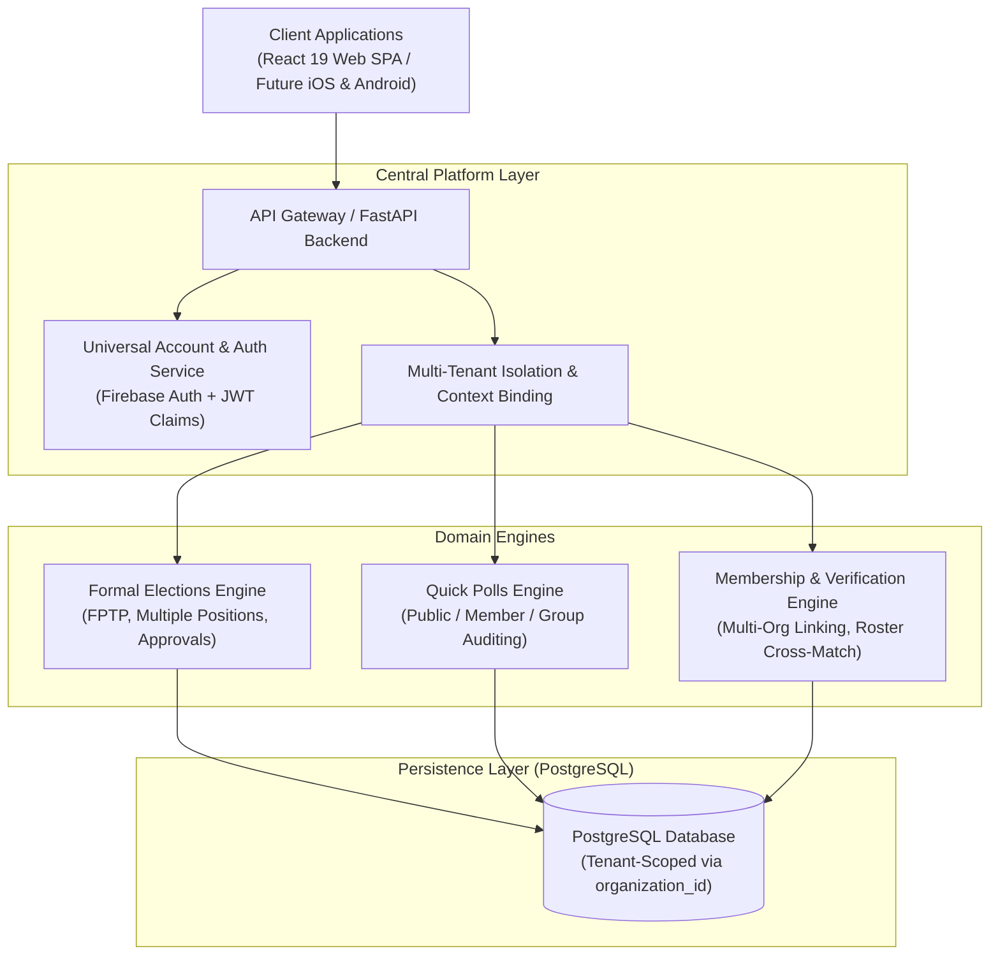
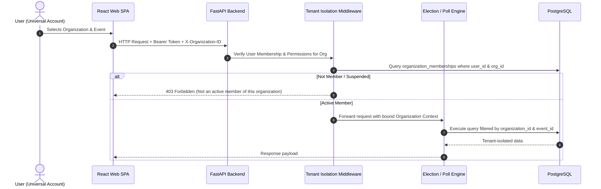

# SYSTEM_ARCHITECTURE.md — Multi-Tenant System Architecture

This document specifies the target multi-tenant system architecture of **UniVote**, outlining the structural transition from the prototype to a multi-organization voting and polling platform.

---

## 1. Architectural Vision & Scope

UniVote is an organizational voting platform serving diverse membership-based bodies:
- **Universities & Colleges**: Student Representative Council (SRC) ballots, faculty boards, course representative voting.
- **Academic Departments**: Departmental executive elections, committee polls.
- **Student Associations & Clubs**: Sports clubs, debate societies, student unions.
- **Companies & Corporate Boards**: Staff representatives, shareholder and board resolutions.
- **Professional Associations & Trade Unions**: Executive officer elections, constitution ratifications.

Each organization operates as an independent tenant within a shared, centralized infrastructure with strict data isolation.

---

## 2. Multi-Tenant Architectural Topology

UniVote employs a **Shared Database, Shared Schema with Column-Level Tenant Isolation**:
- Every organization-scoped table contains an indexed foreign key: `organization_id UUID NOT NULL REFERENCES organizations(id) ON DELETE CASCADE`.
- FastAPI route dependencies and SQLAlchemy query builders automatically bind and filter queries to the active tenant scope (`current_organization`).
- Tenant isolation is authoritatively enforced at the backend dependency and query layers.

### Logical Separation of Tenancy Boundaries:
1. **Platform Scope**: Platform Super Admins oversee platform uptime, organization creation, system-wide configuration, and global audit streams.
2. **Organization Scope**: Organization Admins configure membership groups, custom fields, verification rosters, Election Officials, and Poll Creators.
3. **Event Scope (Election / Poll)**: Scoped to specific elections or polls, governing ballot access, candidate nomination, voter eligibility, and result sign-off.

---

## 3. Core Subsystems & Interaction Patterns

---

## 4. Current Prototype vs. Target Architecture

| Component | Current Prototype Implementation | Target Multi-Tenant Architecture |
|---|---|---|
| **Tenancy** | Single-tenant (implicit single university context) | Multi-tenant (`organizations`, multi-org memberships) |
| **User Identity** | User account tied directly to a single `student_id` | Universal user account belonging to multiple organizations via `organization_memberships` |
| **Roles** | Static global enum (`STUDENT`, `ELECTION_OFFICIAL`, `SUPER_ADMIN`) | 6 Scoped Roles: Platform Super Admin, Org Admin, Election Official, Election Super Admin, Member/Voter, Poll Creator |
| **Voting Capabilities** | Draft departmental election configuration only | Two distinct modules: **Formal Elections** (multi-position, approval workflow) and **Quick Polls** (informal, lightweight) |
| **Ballot Security** | Basic database schema (no vote casting tables yet) | Cryptographic voter/ballot separation, audit logging, vote editing before close |
| **Clients** | React 19 + TypeScript (Vite) | Web SPA + Native iOS & Android apps consuming identical FastAPI REST APIs |
| **Hosting Strategy** | Neon / Supabase + Local FastAPI / Vite | Vercel (Frontend), Render (Backend), Managed PostgreSQL (Neon / Supabase / AWS RDS) |

---

## 5. Architectural Invariants

1. **Strict Data Isolation**: An authenticated request can never view or modify data outside its designated `organization_id` unless executed by a verified Platform Super Admin.
2. **Universal Identity**: A single email account represents a person across the entire UniVote ecosystem. User credentials belong to the platform, while memberships belong to organizations.
3. **Authoritative Backend Boundary**: Client applications (Web, iOS, Android) cannot declare or manipulate organizational roles. All permissions are evaluated server-side per request.
4. **Decoupled Verification vs. Eligibility**: Organization membership verification confirms identity within an institution; eligibility determines permission to vote in a specific election or poll.
