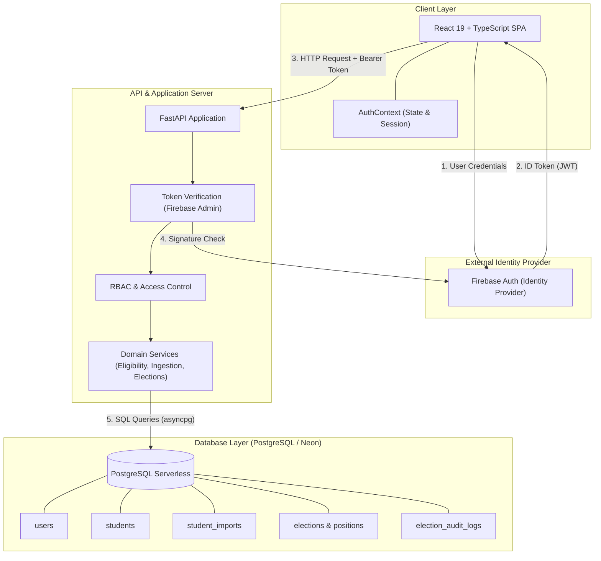

# SYSTEM_OVERVIEW.md — UniVote High-Level System Architecture

## 1. Executive Summary

**UniVote** is a specialized electronic voting platform engineered to meet the compliance, integrity, and scalability requirements of modern tertiary institutions. The platform supports complex institutional structures, ranging from departmental student associations to university-wide Student Representative Council (SRC) elections.

## 2. Core Architectural Tenets

1. **Decoupled Identity and Authorization**: Identity verification is handled via Google's enterprise-grade Firebase Authentication infrastructure, while institutional access control is strictly maintained on the server within FastAPI.
2. **Authoritative Roster Synchronization**: Student voting rights originate from authoritative academic records imported directly by authorized university administrators, preventing fraudulent account creation from influencing elections.
3. **Auditability and Traceability**: All critical configuration actions, lifecycle status transitions, approvals, and imports are logged with immutable audit trails.
4. **Resilient Relational Storage**: All core entities are modeled with strict relational integrity, composite unique constraints, and foreign key rules in PostgreSQL.

## 3. High-Level Component Topology

## 4. Key Subsystems

- **Authentication Subsystem**: Handles user registration, Google OAuth, email verification, password recovery, and token issuance.
- **Roster Ingestion Subsystem**: Validates and ingests official university rosters (.csv, .xlsx), performing header validation and conflict resolution.
- **Verification & Eligibility Engine**: Compares applicant credentials against active official student rosters and calculates election-specific voter eligibility.
- **Election Management Subsystem**: Enables election creation, candidate position structuring, official assignment, and a multi-tier approval workflow.
- **Governance & Administration Subsystem**: Provides Super Admins with role assignment controls, account deactivation, and real-time database metric rollups.

For detailed domain documentation, refer to:
- [FRONTEND.md](FRONTEND.md)
- [BACKEND.md](BACKEND.md)
- [AUTHENTICATION.md](AUTHENTICATION.md)
- [AUTHORIZATION.md](AUTHORIZATION.md)
- [DATABASE.md](DATABASE.md)
