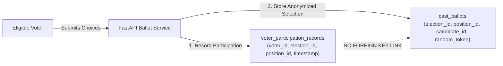

# VOTING_SECURITY.md — Ballot Secrecy, Integrity & Auditability

This document specifies the security requirements, ballot secrecy guarantees, anti-tampering controls, and unresolved cryptographic considerations in **UniVote**.

---

## 1. Separation of Voter Identity and Secret Ballots

A core requirement of UniVote is that **no administrator, election official, or database engineer can inspect an individual's secret vote**.

Storing voter records and ballots in separate tables does not automatically guarantee ballot secrecy if foreign keys, timestamps, or database transaction logs can correlate the two. UniVote enforces strict physical and logical separation:

### Architectural Requirements:
1. **Participation Tracking**: The `voter_participation_records` table records *that* a voter participated in an election to prevent duplicate voting and support vote editing before close.
2. **Anonymized Cast Ballots**: The `cast_ballots` table records *what* candidate choices were made, referenced only by an anonymized cryptographic token or blind hash.
3. **Vote Editing Without Compromise**: When a voter updates their ballot before the election closes, their prior anonymous token is superseded without ever exposing the relationship between their real identity and candidate selections in database queries.

---

## 2. Threat Mitigations & Security Guarantees

| Electoral Threat | Target Mitigation Strategy |
|---|---|
| **Duplicate Voting** | Unique composite constraint on `(voter_id, election_id, position_id)` in the participation ledger. |
| **Official Ballot Peeking** | Election Officials have zero read access to individual cast ballots. Tallies are calculated via aggregated SQL functions (`COUNT()`) only after voting closes. |
| **Premature Result Leaks** | Strict backend visibility rules. Results remain hidden (`status = 'ENDED'`) until formal multi-stage sign-off is completed. |
| **Ballot Tampering** | Cast ballots are hashed and timestamped. System modifications are tracked in `election_audit_logs`. |
| **Credential & Account Theft** | Firebase Auth handles credential management, brute-force throttling, and MFA. |

---

## 3. Auditable Result Approvals & Publication

Elections cannot release results immediately upon voting closure:
1. **Automated Counting**: Backend computes aggregate vote counts upon closing time.
2. **Election Official Inspection**: Assigned Election Officials review turnout numbers, examine statistical anomalies, and submit their recommendations.
3. **Election Super Admin Final Sign-Off**: The designated Election Super Admin conducts final certification (`POST /api/elections/{id}/final-approve`), transitioning status to `RESULTS_PUBLISHED`.

---

## 4. Open Security & Cryptographic Design Decisions

The following design considerations remain under active review:

### ODD-001: Anonymous Ballot Token Storage Pattern
- **Question**: What is the most resilient cryptographic mechanism to allow voters to edit their choices prior to election close without linking their real identity to their candidate choice in database logs?
- **Candidate Solutions**:
  1. *Hashed One-Time Client Token*: Issue an encrypted client-held token used to supersede prior votes.
  2. *Periodic Batch Shuffling*: Periodically mix and shuffle cast ballots in batches.

### ODD-002: Public Quick Poll Anti-Stuffing Mechanism
- **Question**: For `PUBLIC` audience Quick Polls where users do not have verified organization accounts, what balance of friction vs. integrity should be used?
- **Candidate Solutions**:
  1. Browser canvas fingerprinting + IP subnet rate-limiting.
  2. Cloudflare Turnstile / reCAPTCHA challenges.
  3. Lightweight single-use email verification tokens.
