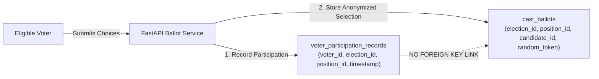

# BALLOT_SECURITY.md — Ballot Secrecy, Integrity & Auditability

## 1. Overview

Electoral trust relies on two seemingly opposing requirements:
1. **Ballot Secrecy**: No one (including system administrators, election officials, or database engineers) should be able to determine how an individual cast their vote.
2. **Voter Verification & Integrity**: The system must guarantee that only eligible voters participate, that each voter votes at most once per position, and that ballots cannot be forged or manipulated.

---

## 2. Separation of Voter Identity and Ballot Secrecy

In the target architecture, UniVote decouples the voter audit receipt from the cast choices:

### Decoupling Rules:
- The **`voter_participation_records`** table tracks *that* a voter participated in an election to prevent duplicate voting and support ballot editing before close.
- The **`cast_ballots`** table records *what* choices were made, associated only with a random cryptographic token or anonymized blind reference.
- **Vote Editing Mechanism**: When a voter updates their vote before the election closes, their prior anonymous ballot token is invalidated/replaced without ever linking the voter's real identity to their candidate choice in the database.

---

## 3. Threat Mitigations & Security Guarantees

| Electoral Threat | Target Mitigation Strategy |
|---|---|
| **Duplicate Voting** | Unique composite constraint on `(voter_id, election_id, position_id)` in the participation ledger. |
| **Official Ballot Peeking** | Election Officials have zero read access to individual ballots. Tallies are calculated via aggregated SQL functions (`COUNT()`) only after voting closes. |
| **Premature Result Leaks** | Strict backend visibility rules. Results remain hidden (`status = 'ENDED'`) until formal multi-stage sign-off is completed. |
| **Ballot Tampering** | Cast ballots are hashed and timestamped. System modifications are tracked in `election_audit_logs`. |
| **Credential & Account Theft** | Firebase Auth handles credential management, brute-force throttling, and MFA. |

---

## 4. Multi-Stage Result Approvals & Certification

Elections cannot publish results directly upon conclusion:
1. **Tallying**: Backend computes exact vote counts.
2. **Election Official Review**: Assigned Election Officials inspect turnout, verify consistency, and submit recommendations.
3. **Election Super Admin Final Sign-Off**: The designated Election Super Admin conducts final certification (`POST /api/elections/{id}/final-approve`), transitioning the election status to `RESULTS_PUBLISHED`.
