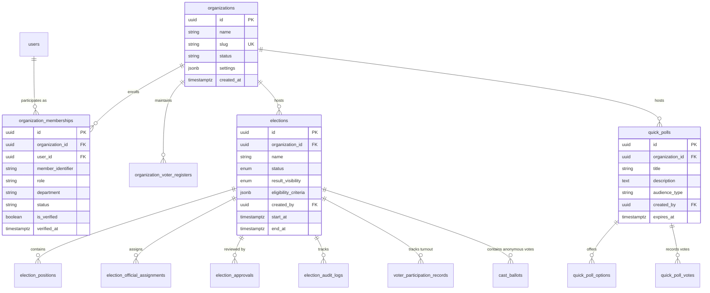

# DATABASE_ARCHITECTURE.md — Multi-Tenant Database Design

## 1. Overview

The UniVote database architecture is evolving from a single-institution schema into a multi-tenant relational schema powered by **PostgreSQL**, managed with **SQLAlchemy 2.0 (AsyncIO)** and **Alembic**.

---

## 2. Multi-Tenant Relational Schema Diagram

---

## 3. Schema Transition & Migration Roadmap

### Phase A: Current Existing Tables (Single-Tenant Prototype)
- `users`: Stores global user accounts with an embedded university `student_id`.
- `students`: Stores official student records for a single university.
- `student_imports`: Tracks spreadsheet imports for the university.
- `elections`, `election_positions`, `election_official_assignments`, `election_approvals`, `election_audit_logs`.

### Phase B: Target Multi-Tenant Additions (Future Migrations)
1. **`organizations` Table**: Stores tenant metadata, institutional domain constraints, and branding.
2. **`organization_memberships` Table**: Decouples `student_id` from `users`, allowing users to have memberships across multiple organizations.
3. **`organization_voter_registers` Table**: Replaces the single-institution `students` table with tenant-scoped voter rosters.
4. **`quick_polls` & `quick_poll_options` Tables**: Implements the lightweight quick polling module.
5. **`cast_ballots` & `voter_participation_records` Tables**: Implements cryptographic vote secrecy.
