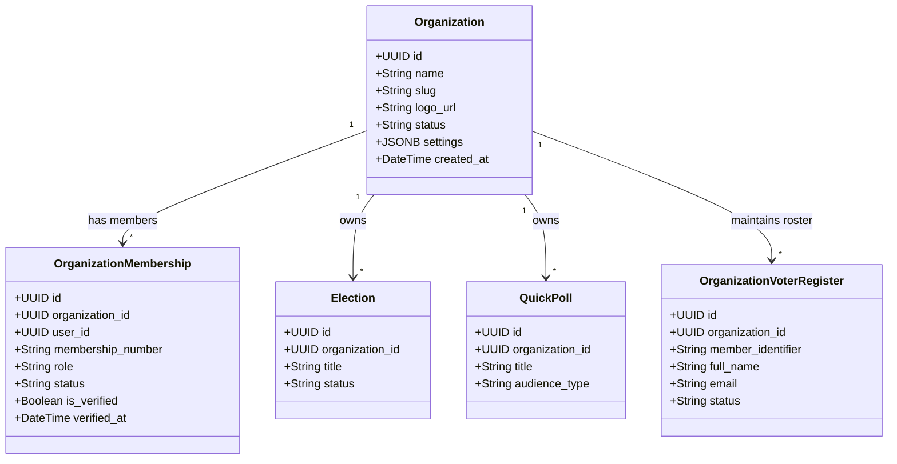
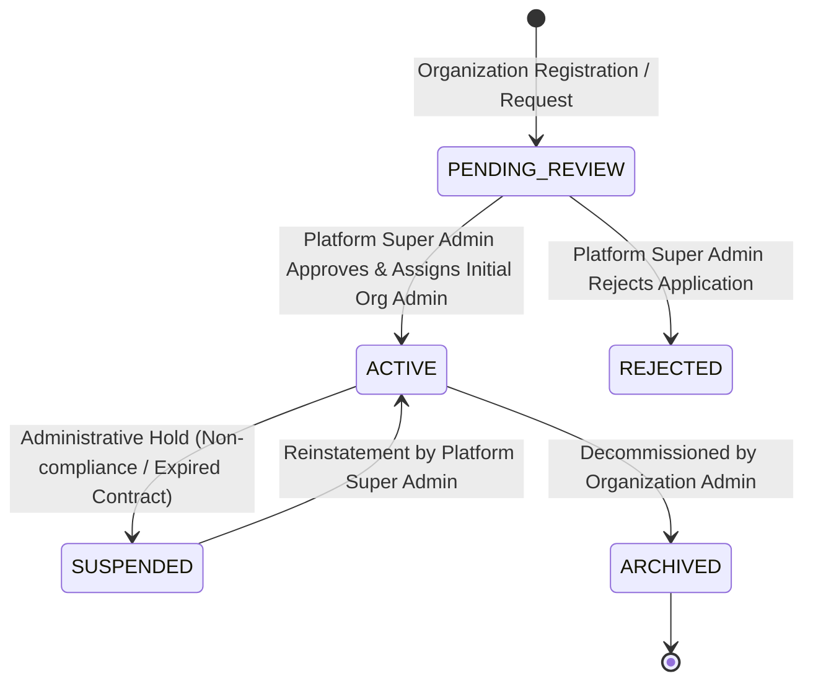

# MULTI_TENANCY.md — Multi-Tenant Architecture & Data Isolation

## 1. Overview

UniVote supports multiple independent organizations (universities, corporate bodies, student associations, trade unions) hosted within a single centralized platform. This document defines the tenant isolation model, organization lifecycle, and data partitioning strategy.

---

## 2. Tenancy Model: Shared Database, Tenant-Scoped Partitioning

UniVote adopts a **Shared Database with Column-Level Organization Partitioning**:
- All tenant-specific tables feature a mandatory foreign key: `organization_id UUID NOT NULL REFERENCES organizations(id) ON DELETE CASCADE`.
- Database queries across elections, polls, candidate lists, voter registers, and audit trails must enforce `WHERE organization_id = :active_org_id`.

---

## 3. Organization Lifecycle

The organization lifecycle is strictly supervised by Platform Super Admins:

### Onboarding Steps:
1. **Creation / Submission**: Prospective organization submits institutional credentials, contact details, and initial admin profile.
2. **Platform Super Admin Review**: Platform Super Admin validates organizational legitimacy and activates the tenant (`status = 'ACTIVE'`).
3. **Initial Org Admin Assignment**: Platform Super Admin grants `ORGANIZATION_ADMIN` role to the primary organizational contact.
4. **Tenant Configuration**: Organization Admin configures departments, branding, membership verification rules, and imports initial voter rosters.

---

## 4. Cross-Tenant Isolation Enforcement

To prevent cross-tenant data leaks, backend requests enforce the following pipeline:

1. **Tenant Context Resolution**:
   - The client passes an `X-Organization-ID` header (or route parameter `/api/orgs/{org_id}/...`).
2. **Membership Validation Dependency (`get_current_org_membership`)**:
   - Resolves the authenticated user's record in `organization_memberships` for the specified `organization_id`.
   - Rejects unverified or suspended members (`403 Forbidden`).
3. **Automatic Query Filtering**:
   - Database queries explicitly append `where(Model.organization_id == active_org_id)`.
   - Prevents SQL enumeration attacks across organizations.
4. **Super Admin Override**:
   - Only users with platform-level `PLATFORM_SUPER_ADMIN` status can bypass tenant scoping for cross-organization auditing or platform maintenance.
