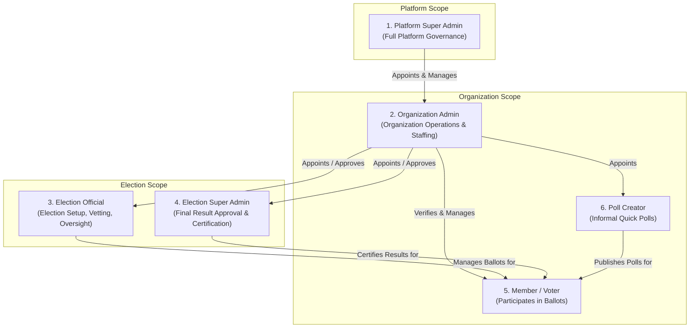

# ROLE_AND_PERMISSION_MODEL.md — Six-Tier Scoped Role & Permission Specification

## 1. Overview

UniVote transitions from a flat, single-institution role model to a hierarchical, scoped role model spanning three operational levels: **Platform**, **Organization**, and **Election / Event**.

---

## 2. Six Scoped Roles Specification

### Role Matrix & Responsibilities

| Role | Scope | Authority & Primary Responsibilities | Appointment Mechanism |
|---|---|---|---|
| **1. Platform Super Admin** | Global / Platform | Manages the entire UniVote infrastructure, reviews/approves new organizations, assigns initial Organization Admins, and audits cross-tenant activities. | Direct database provisioning or internal platform governance. |
| **2. Organization Admin** | Organization | Configures organizational settings, manages membership verification, uploads voter registers, assigns Election Officials, and grants Poll Creator permissions. | Appointed by Platform Super Admin (initial) or existing Org Admin. |
| **3. Election Official** | Specific Election / Org | Configures formal elections, sets up contested positions, vets candidate nominations, monitors live turnout, and conducts preliminary review of tallies. | Assigned by Organization Admin to specific election(s). |
| **4. Election Super Admin** | Specific Election / Org | Holds final certification authority. Reviews election audit trails, signs off on preliminary tallies, approves or rejects results, and certifies public release. | Assigned by Organization Admin or Institutional Returning Officer. |
| **5. Member / Voter** | Organization | Enrolled organizational member. Verifies identity against the institutional register, browses elections/polls, checks eligibility, and casts secret ballots. | Self-registration followed by institutional verification. |
| **6. Poll Creator** | Organization | Authorized member or staff member allowed to configure and publish lightweight informal Quick Polls (e.g. Best Lecturer, Club Awards). | Granted permission by Organization Admin. |

---

## 3. Scope Boundaries & Disambiguation Rules

To maintain strict operational clarity across all code and documentation:

1. **Platform Super Admin vs. Election Super Admin**:
   - The **Platform Super Admin** oversees the global server infrastructure, billing, and tenant onboarding across all organizations.
   - The **Election Super Admin** is an institutional role (such as an Electoral Commissioner or Dean of Students) whose sole jurisdiction is giving final approval to election results within their organization.
2. **Organization Admin vs. Election Official**:
   - The **Organization Admin** manages institutional operations, voter registers, and member rosters.
   - The **Election Official** has day-to-day oversight of an individual election, its candidates, and ballot setups.
3. **Members vs. Eligible Voters**:
   - A **Member** is a verified user belonging to an organization.
   - An **Eligible Voter** is a member who satisfies the specific criteria (department, cohort, level) established for a given ballot.
