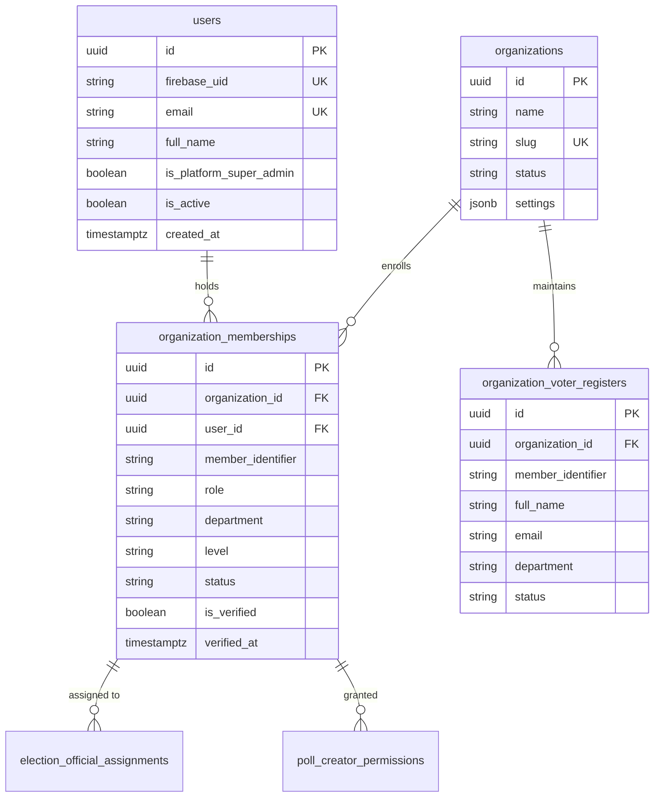
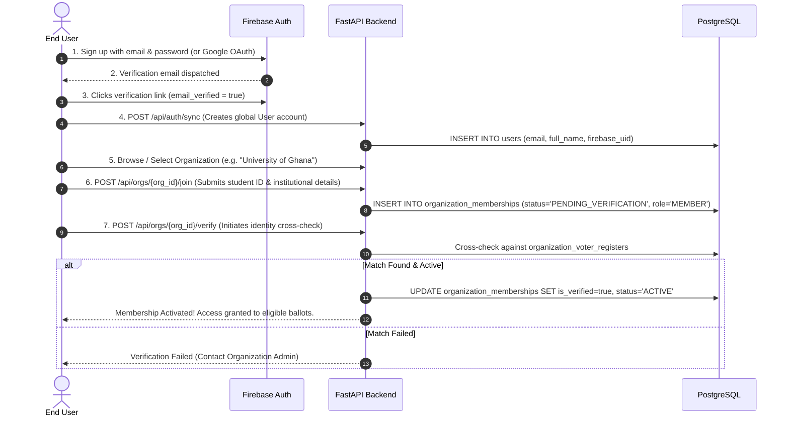

# USER_AND_MEMBERSHIP_ARCHITECTURE.md — Universal Accounts & Multi-Organization Memberships

## 1. Overview

UniVote completely decouples the global **User Account** from localized **Organization Memberships**. A single person registers once with an email address and can join multiple universities, student associations, or corporate organizations with distinct roles, identifiers, and verification statuses.

---

## 2. Core Separation of Concepts

The target architecture distinguishes five fundamental entities:

1. **User Account (`users`)**: Global platform identity. Owns email, password credentials (managed by Firebase Auth), global profile metadata, and platform-level active status.
2. **Organization (`organizations`)**: Distinct institutional tenant.
3. **Organization Membership (`organization_memberships`)**: Represents a user's relationship with a specific organization. Owns institutional ID (e.g., Student ID, Staff ID), department, organizational role, verification status, and membership state.
4. **System Role**: The authority assigned to a user within a specific scope (Platform-level vs. Org-level vs. Election-level).
5. **Voting Eligibility**: The conditional right to cast a ballot in a specific formal election or quick poll based on membership attributes or uploaded registers.

---

## 3. Universal Registration & Onboarding Lifecycle

---

## 4. Multi-Membership Switching & Context

Users participating in multiple organizations (e.g. an engineering student who is also an executive member of the Debate Club) switch contexts seamlessly:
- The frontend dashboard provides an **Organization Switcher** component.
- Selecting an organization updates the active context (`currentOrgId`).
- Subsequent API requests provide the `X-Organization-ID` header.
- The user's role and capabilities automatically adapt to their assigned role in that specific organization.
