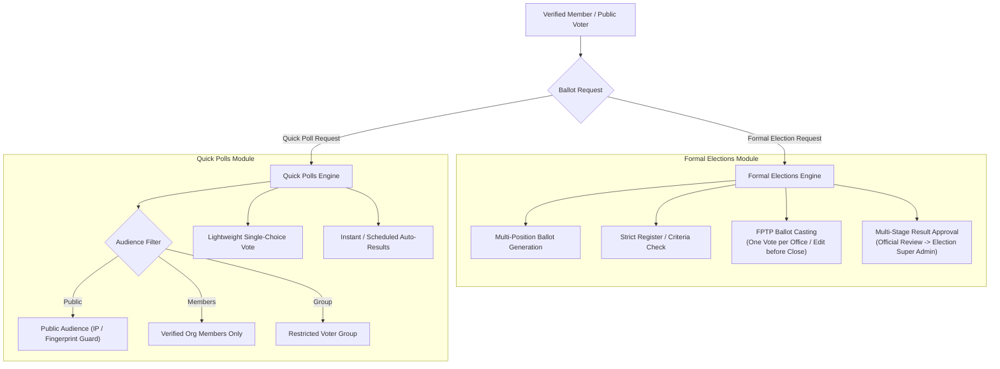

# VOTING_ARCHITECTURE.md — Dual Voting Engine Architecture

## 1. Overview

UniVote supports two distinct voting experiences tailored to different governance requirements:
1. **Formal Elections**: Highly regulated, auditable ballots with candidate vetting, multiple contested offices, strict voter eligibility, and certified multi-tier result approval.
2. **Quick Polls**: Lightweight, informal voting activities designed for student engagement, awards, social rankings, and opinion surveys.

---

## 2. Formal Elections Engine

### Key Capabilities:
- **Electoral Scope**: Institutional, faculty, departmental, or union-wide.
- **Multiple Positions per Election**: Contested offices (e.g., President, General Secretary, Financial Controller) with configurable winner counts (`number_of_winners`).
- **Position-Specific Eligibility Overrides**: While an election may target the entire university, specific positions can enforce tailored restrictions (e.g., "Faculty Rep" restricted only to students of that faculty).
- **Candidate Vetting & Platforms**: Candidates apply for offices, submit manifesto documents, undergo background vetting by Election Officials, and appear on the official ballot upon approval.
- **First-Past-The-Post (FPTP) Mechanics**: One vote allowed per position; optional blank votes ("Abstain") permitted.
- **Vote Editing Prior to Election Closure**: Voters may adjust their ballot selections at any time while the election remains `LIVE`. Once the closing timestamp passes, ballots are permanently sealed.
- **Controlled Multi-Tier Approval**: Results remain hidden until preliminary tallies are verified by Election Officials and officially certified by the **Election Super Admin**.

---

## 3. Quick Polls Engine

### Key Capabilities:
- **Informal Use Cases**: "Best Dressed Student", "Favorite Lecturer", "Department Dinner Venue", "Club Executive of the Year".
- **Zero-Roster Ingestion**: Quick Polls do not require uploading a separate CSV/XLSX voter register. Eligibility is established dynamically through existing verified organization memberships.
- **Flexible Audience Targeting**:
  1. *Public Audience*: Open to all visitors (with fingerprint/IP protections).
  2. *Verified Organization Members*: Open to any active verified member of the organization.
  3. *Restricted Voter Groups*: Restricted to specific cohorts (e.g., Level 400 students).
- **Lightweight Administration**: Configured directly by authorized **Poll Creators** without requiring formal electoral commission approval.
- **Automated Results**: Results can publish in real-time or immediately upon poll expiry without formal sign-off.
