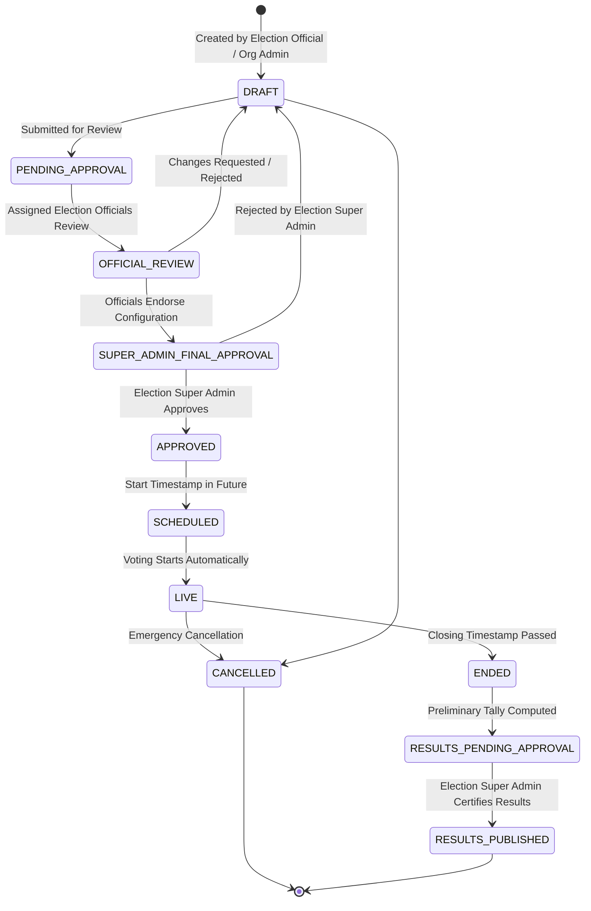

# FORMAL_ELECTIONS.md — Formal Election Lifecycle & Ballot Management

## 1. Overview

The **Formal Elections** module manages regulated institutional elections, featuring candidate vetting, contested offices, voter eligibility rules, First-Past-The-Post balloting, vote editing before close, and multi-tier result certification.

---

## 2. Election Lifecycle State Machine

---

## 3. Position Hierarchy & Contested Offices

An election contains one or more contested offices (`election_positions`):
- **Display Order**: Determines sort order on the digital ballot paper.
- **Winners Count (`number_of_winners`)**: Supports single-seat offices (President) and multi-seat offices (Executive Committee, 3 seats).
- **Position-Specific Eligibility**: Allows restricting specific offices to certain cohorts (e.g., Final Year Class Rep).

---

## 4. First-Past-The-Post (FPTP) & Vote Editing Mechanics

1. **Ballot Retrieval**: Eligible voters receive a dynamic ballot displaying active positions and vetted candidates.
2. **Choice Selection**: Voter selects up to `number_of_winners` candidates per office, or marks "Abstain" (Blank Vote).
3. **Receipt Issuance**: The server issues a cryptographic receipt token confirming vote capture.
4. **Vote Editing Before Close**: A voter may return to the ballot, review their selections, and submit updated choices while the election is `LIVE`. Their earlier anonymous ballot is superseded without compromising ballot secrecy.
