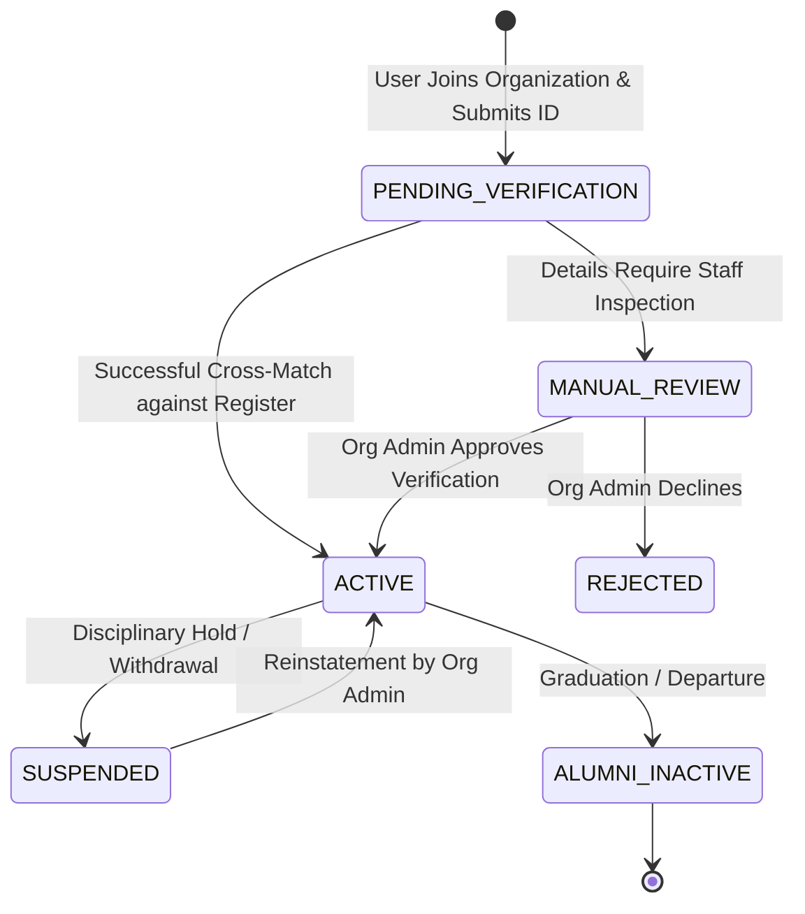

# MEMBERSHIP_MANAGEMENT.md — Organization Membership & Verification

## 1. Overview

The **Membership Management** module governs how universal user accounts discover, join, verify, and maintain their standing within organizations.

---

## 2. Membership States

Every user's relationship with an organization is modeled via an `organization_memberships` record with five distinct statuses:

- **`PENDING_VERIFICATION`**: User has requested membership and submitted their institutional identifier (e.g. Student ID); automated cross-match is pending.
- **`ACTIVE`**: Identity is verified against the official register. User can access member polls and check election eligibility.
- **`MANUAL_REVIEW`**: Mismatches in legal names or special enrollment statuses escalated to the Organization Admin.
- **`SUSPENDED`**: Member is barred from voting or participating in the organization's activities.
- **`ALUMNI_INACTIVE`**: Retains historical record of voting participation without active voting privileges.

---

## 3. Automated Cross-Match Engine

When a user initiates verification, the backend runs `compare_identity()` against the organization's active voter register:
1. Matches `member_identifier` (Student ID / Staff ID) case-insensitively.
2. Verifies institutional email domain or exact email match.
3. Performs whitespace-collapsed, case-insensitive full name comparison.
4. On match, sets `is_verified = True` and transitions status to `ACTIVE`.
