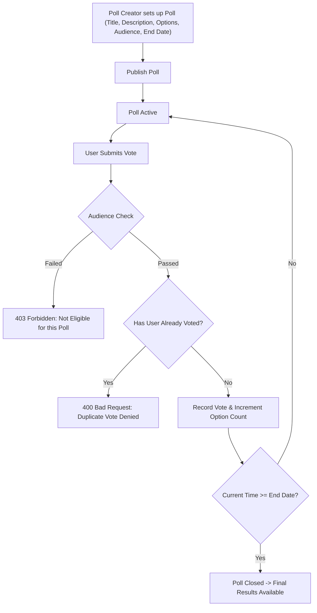

# QUICK_POLLS.md — Quick Polls Specification & Lightweight Voting

## 1. Overview

The **Quick Polls** module introduces an informal voting capability across UniVote. Unlike Formal Elections, Quick Polls require no roster uploads, allow rapid configuration by **Poll Creators**, and cater to campus engagement, social contests, and student pulse surveys.

---

## 2. Formal Elections vs. Quick Polls Comparison

| Feature | Formal Elections | Quick Polls |
|---|---|---|
| **Primary Goal** | High-stakes constitutional governance & officer elections | High-engagement informal awards, opinion polls, event selections |
| **Roster Ingestion** | Mandatory CSV/XLSX official register cross-match | Zero roster ingestion; leverages existing verified memberships |
| **Structure** | Multiple positions per election with candidate vetting | Single-question ballots with multiple nominee cards or text options |
| **Creator Role** | Election Officials / Organization Admins | Poll Creators (appointed by Org Admin) |
| **Approval Workflow** | Multi-tier sign-off (`DRAFT` → `OFFICIAL_REVIEW` → `SUPER_ADMIN`) | Instant publish or scheduled release without formal approvals |
| **Vote Modification** | Vote editing allowed before election close | Single immutable submission per voter |
| **Result Publication** | Certified by Election Super Admin | Instant real-time tallies or automated release upon poll expiry |

---

## 3. Audience Targeting Configurations

Quick Polls support three flexible audience modes:

1. **`PUBLIC` Audience**:
   - Open to anyone (including non-members).
   - Protected against vote stuffing using client fingerprinting, IP rate-limiting, and reCAPTCHA/Turnstile verification.
   - Ideal for: Open open-day awards, prospective student polls.
2. **`ORGANIZATION_MEMBERS` Audience**:
   - Restricted to authenticated users holding an active verified membership in the organization.
   - Ideal for: "Favorite Department Lecturer", "Best Dressed Student", "Dinner Venue Choice".
3. **`RESTRICTED_GROUP` Audience**:
   - Restricted to specific sub-groups within the organization (e.g. Computer Science Level 300).
   - Ideal for: Course rep straw polls, departmental project topic selections.

---

## 4. Lifecycle & Anti-Duplication Safeguards

