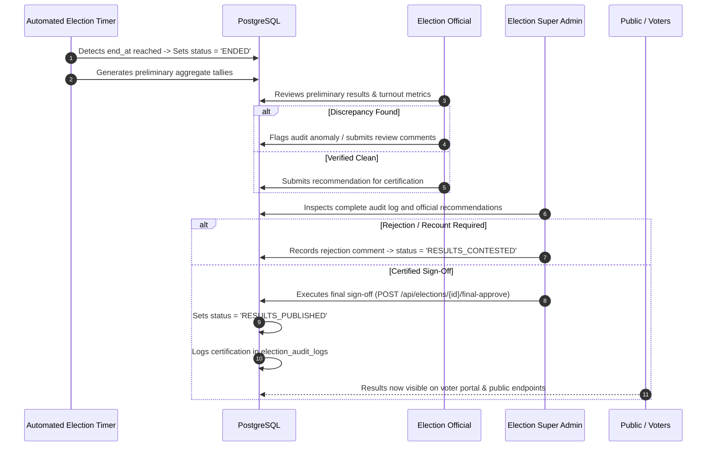

# RESULTS_AND_APPROVALS.md — Result Tallying, Approval Pipelines & Auditability

## 1. Overview

The **Results and Approvals** module enforces institutional checks and balances, guaranteeing that formal election outcomes are strictly validated, reviewed, and certified before becoming public.

---

## 2. Multi-Stage Approval Pipeline

---

## 3. Result Visibility Configurations

An election's `result_visibility` setting controls when and to whom tallies are exposed:

1. **`HIDDEN_UNTIL_ENDED`**:
   - Zero turnout or vote totals are visible while voting is active.
   - Upon closing, results remain restricted to staff until certified by the **Election Super Admin**.
2. **`OFFICIALS_ONLY_DURING_VOTING`**:
   - Real-time voter turnout and interim counts are visible strictly to assigned Election Officials and Election Super Admins to monitor participation.
   - Hidden from students and general members until post-election certification.
3. **`PUBLIC_LIVE`**:
   - Real-time voter turnout is displayed publicly.
   - Ideal for campus excitement and public engagement where transparency does not bias ongoing balloting.

---

## 4. Comprehensive Audit Trail

All result transitions and approvals create immutable entries in `election_audit_logs`:
- **`ACTION`**: `ELECTION_ENDED`, `TALLY_COMPUTED`, `OFFICIAL_REVIEW_SUBMITTED`, `SUPER_ADMIN_CERTIFIED`, `RESULTS_PUBLISHED`.
- **`DETAILS`**: JSONB snapshot of vote totals, reviewer notes, and client IP addresses.
