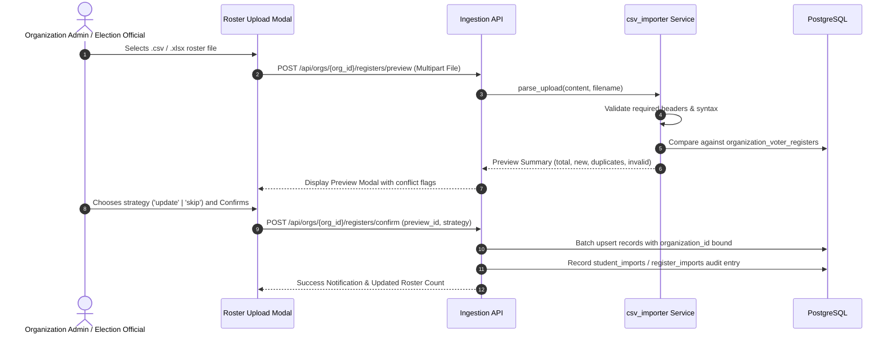

# VOTER_ELIGIBILITY.md — Voter Register Ingestion & Eligibility Management

## 1. Overview

Voter eligibility in UniVote bridges the gap between institutional enrollment data and active ballots. This module governs the ingestion of official rosters (.csv, .xlsx) and evaluates voter qualification for formal elections and quick polls.

---

## 2. Ingestion Workflow & Conflict Resolution

---

## 3. Dynamic Eligibility Evaluation

When evaluating an election ballot, the system executes a 4-tier check:

1. **User Standing**: Global account must be active (`user.is_active == True`).
2. **Organization Membership Standing**: User must have an `ACTIVE` and `is_verified == True` membership within the hosting organization.
3. **Register Match**: The linked record in the organization's roster must be active (`status == 'ACTIVE'`).
4. **Election Criteria & Position Overrides**:
   - *Election-wide Criteria*: Department, level, or faculty filter stored in `Election.eligibility_criteria`.
   - *Position-specific Overrides*: Individual contested positions can restrict eligibility further (e.g., "Engineering Rep" restricted strictly to Engineering members).

---

## 4. Expansion: Direct Institutional Database Connectors

As an expansion item beyond spreadsheet uploads, UniVote is designed to support direct API/database synchronization with campus Student Information Systems (SIS) like Banner, PeopleSoft, and Canvas via scheduled sync workers.
