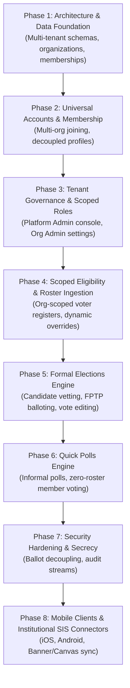

# DEVELOPMENT_PHASES.md — Phased Implementation Strategy

## 1. Overview

This document defines the transition strategy to upgrade UniVote into a multi-tenant platform without disrupting existing prototype workflows or causing database downtime.

---

## 2. Phased Rollout Sequence

---

## 3. Detailed Phase Objectives

### Phase 1: Architecture & Data Foundation
- **Milestone**: Non-breaking database migration introducing `organizations` and `organization_memberships`.
- **Backward Compatibility**: Migrate existing users and elections into a default institutional tenant (e.g., "Default University") to preserve current data.

### Phase 2: Universal Accounts & Membership
- **Milestone**: Users can register with standard emails, browse organizations, and submit institutional identifiers.
- **Verification**: Refactor identity verification to cross-match memberships against organization-specific rosters.

### Phase 3: Tenant Governance & Scoped Roles
- **Milestone**: Platform Super Admin console for tenant approvals and Organization Admin delegation tools for Election Officials and Poll Creators.

### Phase 4: Scoped Eligibility & Roster Ingestion
- **Milestone**: Ingestion of rosters scoped strictly by `organization_id`, backed by position-level eligibility overrides.

### Phase 5: Formal Elections Engine
- **Milestone**: End-to-end voting pipeline with candidate nomination, FPTP voting, vote editing before close, and final Election Super Admin certification.

### Phase 6: Quick Polls Engine
- **Milestone**: High-engagement informal polling module for public, member, and restricted group audiences.

### Phase 7: Ballot Security & Secrecy Hardening
- **Milestone**: Physical and logical decoupling of voter participation logs from anonymous cast ballots.

### Phase 8: Mobile Clients & SIS Connectors
- **Milestone**: Cross-platform iOS/Android apps consuming FastAPI endpoints, alongside direct API connectors to university SIS systems.
