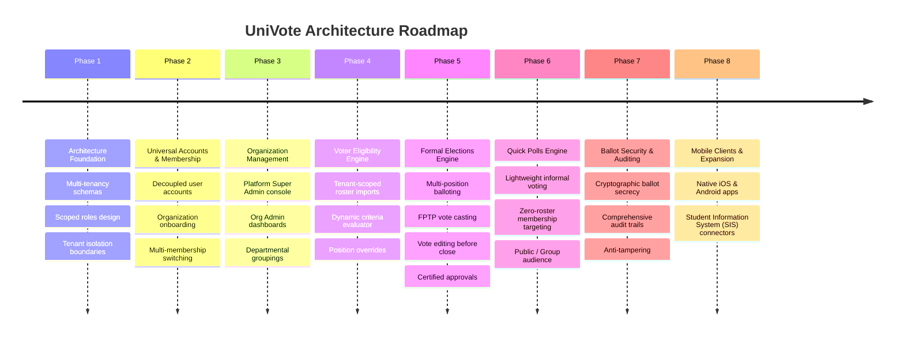

# PRODUCT_ROADMAP.md — UniVote Multi-Tenant Product Roadmap

This document outlines the strategic development phases to evolve UniVote into a multi-tenant voting platform.

---

## Strategic Phases Overview

---

## Phase Breakdown

### Phase 1: Architecture Foundation
- Design multi-tenant database relationships (`organizations`, `organization_memberships`).
- Define 6-tier scoped role authorization model.
- Establish tenant isolation dependencies in FastAPI.
- Plan non-breaking Alembic migration path.

### Phase 2: Universal Accounts & Membership
- Enable universal user self-registration via email and Google OAuth.
- Implement organization discovery and joining workflows.
- Create automated membership verification cross-referencing institutional rosters.
- Support multi-organization membership switching in the UI.

### Phase 3: Organization Management
- Build the Platform Super Admin console for tenant review, activation, and supervision.
- Deliver Organization Admin settings, branding, and departmental group management.
- Implement Election Official and Poll Creator role assignment tools.

### Phase 4: Voter Eligibility Management
- Update CSV/XLSX roster ingestion to bind records to `organization_id`.
- Support dry-run previews, duplicate detection, and import audit logging.
- Implement election-wide eligibility criteria with position-specific overrides.

### Phase 5: Formal Elections
- Complete the multi-position election setup wizard.
- Deliver candidate nomination, manifesto submission, and official vetting workflows.
- Implement First-Past-The-Post voting with optional blank/abstain ballots.
- Enable vote editing prior to election closing.
- Build the multi-tier result review and Election Super Admin certification pipeline.

### Phase 6: Quick Polls
- Implement the informal polling engine for campus engagement.
- Support Public, Organization Member, and Restricted Group audiences.
- Enable instant auto-tallying and scheduled result publication.

### Phase 7: Ballot Security & Governance
- Decouple voter participation tracking from anonymous cast ballots.
- Implement immutable action logging in `election_audit_logs`.
- Hardened result certification and anti-tampering verification.

### Phase 8: Mobile Applications & Institutional Integrations
- Native iOS and Android applications consuming identical FastAPI REST APIs.
- Direct Student Information System (SIS) connectors (Banner, PeopleSoft, Canvas).
